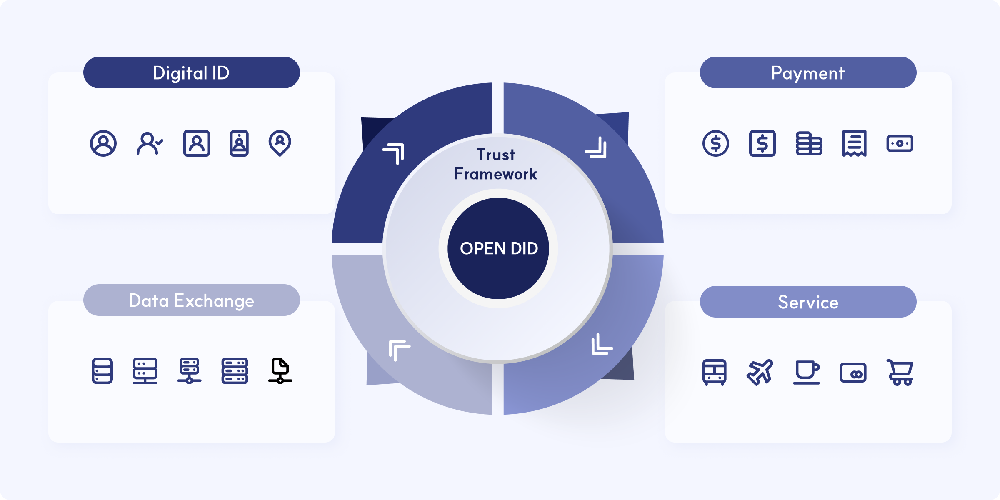

Open DID
==

OPEN DID 플랫폼을 통하여 디지털 세상의 다양한 구성원에게 신뢰와 책임에 기반한 디지털 신원인증시스템을 제공하고자 합니다. 이를 통해 사회적 비용을 감소시키며, 인프라로부터 소외된 계층에게는 "인류 가치 실현을 위한 사회적 책임"을 다할 수 있도록 합니다.

OPEN DID는 많은 국가와 구성원들이 이와같은 생태계를 구성할 수 있도록 핵심 요소들이 디자인 되었습니다.

* OPEN DID 시스템은 참여하는 Entities간 신뢰체인 구성을 위한 Trust Environment, Digital ID 기반의 다양한 증명서를 저장 및 관리할 수 있는 Wallet, 다양한 증명서를 포용하는 Digital ID, 그리고 데이터 보호를 위한 Security로 구성합니다.
* 이러한 OPEN DID 오픈소스의 가치는 향후 온라인에서의 모든 디지털 활동의 근간이 될 것으로 기대합니다.



## 1. Principles
OPEN DID 시스템은 아래와 같은 원칙으로 오픈소스를 제공하고자 합니다. 이러한 원칙들은 신뢰할 수 있는 디지털 신원 인증 환경을 구축하고, 모든 참여자가 공정하고 안전하게 사용할 수 있도록 하기 위함입니다.

* **독립적 동작**: OPEN DID 시스템의 구성 요소들은 서로 간의 의존성을 최소화하여, 개별적으로 동작할 수 있어야 합니다.

* **기술 독립성**: OPEN DID 시스템은 특정 기술이나 도구에 의존하지 않고, 다양한 기술을 포용하고 호환할 수 있도록 설계되어야 합니다.

* **문서화**: OPEN DID 시스템의 구성 요소들에 대해 지속 가능한 관리 및 기술을 선택하기 위하여 설계, 구현, 운영에 대한 문서가 제공되어야 합니다.

* **개방형 표준 준수**: OPEN DID 시스템에서 기술이나 기능을 구현할 때는 개방형 표준(Open standards, preventing vendor and technology lock-in)을 준수해야 합니다.

* **모듈 다양성**: OPEN DID 시스템에 참여하고자 하는 사업자들은 필요에 따라 원하는 구성 요소들을 자유롭게 선택하고 조합할 수 있어야 합니다.

* **보안 강화**: OPEN DID 시스템은 사용자 인증 및 데이터를 보호하기 위한 적절한 보안 기능이 포함되어야 합니다.

* **글로벌 표준 준수**: OPEN DID 시스템은 개인 데이터 보호(Privacy by design approach) 및 데이터 보호에 대한 글로벌 표준(Data protection principles in practice)을 준수해야 합니다.

* **제로 트러스트 통신의 보장**: OPEN DID 시스템의 각 구성 요소들은 서로를 안전하게 신뢰할 수 있는 통신 메커니즘을 구축할 수 있어야 합니다.

* **자유로운 기여**: OPEN DID 프로젝트는 누구나 자유롭게 기여할 수 있어야 합니다.

* **투명성**: OPEN DID 프로젝트의 결정 및 변경 사항은 공개적으로 투명하게 이루어져야 합니다.

* **상업용 라이선스 제한**: OPEN DID의 모든 컴포넌트 내에서는 상업용 라이선스를 사용하지 않습니다.

* **원칙 준수**: OPEN DID 시스템의 각 원칙은 다른 원칙을 위반하지 않는 선에서 시스템 설계와 구현에 적용되어야 합니다.

## 2. 용어집
OpenDID 플랫폼에서 사용되는 주요 용어를 이해하는 것은 프로젝트의 개념을 파악하는 데 매우 중요합니다.

각 용어에 대한 자세한 설명은 [glossary_ko.md](docs/guide/glossary_ko.md)에서 확인할 수 있습니다.

## 3. 시스템 구조
OpenDID의 전체적인 시스템 구성을 이해하기 위해, OpenDID의 컴포넌트와 소프트웨어 아키텍처를 참조하세요.

OpenDID의 각 컴포넌트가 어떤 역할을 수행하는지, 그리고 이들이 어떻게 상호작용하여 데이터 흐름을 형성하는지를 설명합니다.
- [Components](docs/concepts/components.md): OpenDID의 구성 요소를 설명합니다.
- [Software Architecture](docs/architecture/Software%20Architecture.md): 전체 시스템 아키텍처 및 데이터 흐름을 설명합니다.

## 4. OpenDID 표준
OpenDID에서 정의한 표준에 대해 알아봅니다. 

OpenDID 표준은 상호운용성을 촉진하고, 보안성을 강화하며, 분산된 신원 관리의 핵심 원칙을 따르도록 설계되었습니다. 

이를 통해 프로젝트 전반에 걸쳐 일관된 규칙과 프로토콜을 적용합니다.

자세한 내용은 다음 문서를 참조하세요:
1. 개념(Concepts): OpenDID의 주요 개념을 설명합니다.
2. 보안(Security): 보안 모델과 관련된 사항을 다룹니다. OpenDID 플랫폼이 보안 위협으로부터 어떻게 보호되는지 설명합니다.
<!--3. [Protocol](docs/protocol): OpenDID에서 사용하는 통신 프로토콜에 대한 설명입니다. 네트워크 간의 상호작용 방식을 다룹니다.-->

  
## 5. DID Repository 목록

#### Demo

1. [did-demo-app](https://github.com/OmniOneID/did-demo-app)

#### Document

1. [did-doc-architecture](https://github.com/OmniOneID/did-doc-architecture)
1. [did-release](https://github.com/OmniOneID/did-release)

#### Server SDK

1. [did-blockchain-sdk-server](https://github.com/OmniOneID/did-blockchain-sdk-server)
1. [did-core-sdk-server](https://github.com/OmniOneID/did-core-sdk-server)
1. [did-crypto-sdk-server](https://github.com/OmniOneID/did-crypto-sdk-server)
1. [did-datamodel-sdk-server](https://github.com/OmniOneID/did-datamodel-sdk-server)
1. [did-wallet-sdk-server](https://github.com/OmniOneID/did-wallet-sdk-server)
1. [did-cli-tool-server](https://github.com/OmniOneID/did-cli-tool-server)
1. [did-common-sdk-server](https://github.com/OmniOneID/did-common-sdk-server)
1. [did-zkp-sdk-server](https://github.com/OmniOneID/did-zkp-sdk-server)
1. [did-issuer-sdk-server](https://github.com/OmniOneID/did-issuer-sdk-server)
1. [did-ta-sdk-server](https://github.com/OmniOneID/did-ta-sdk-server)
1. [did-verifier-sdk-server](https://github.com/OmniOneID/did-verifier-sdk-server)

#### Mobile SDK 

1. [did-client-sdk-aos](https://github.com/OmniOneID/did-client-sdk-aos)
1. [did-client-sdk-ios](https://github.com/OmniOneID/did-client-sdk-ios)
1. [did-client-sdk-aos-kotlin](https://github.com/OmniOneID/did-client-sdk-aos-kotlin)
1. [did-proximity-sdk-android](https://github.com/OmniOneID/did-proximity-sdk-android)
1. [did-proximity-sdk-ios](https://github.com/OmniOneID/did-proximity-sdk-ios)

#### Server Application 

1. [did-besu-contract](https://github.com/OmniOneID/did-besu-contract)
1. [did-issuer-server](https://github.com/OmniOneID/did-issuer-server)
1. [did-ta-server](https://github.com/OmniOneID/did-ta-server)
1. [did-verifier-server](https://github.com/OmniOneID/did-verifier-server)
1. [did-api-server](https://github.com/OmniOneID/did-api-server)
1. [did-ca-server](https://github.com/OmniOneID/did-ca-server)
1. [did-demo-server](https://github.com/OmniOneID/did-demo-server)
1. [did-wallet-server](https://github.com/OmniOneID/did-wallet-server)
1. [did-ledger-service-server](https://github.com/OmniOneID/did-ledger-service-server)
1. [did-orchestrator-server](https://github.com/OmniOneID/did-orchestrator-server)
1. [did-omn-resolver-driver-server](https://github.com/OmniOneID/did-omn-resolver-driver-server)
1. [did-proxy-server](https://github.com/OmniOneID/did-proxy-server)

#### Mobile Application 

1. [did-ca-aos](https://github.com/OmniOneID/did-ca-aos)
1. [did-ca-ios](https://github.com/OmniOneID/did-ca-ios)
1. [did-proximity-verifier-android](https://github.com/OmniOneID/did-proximity-verifier-android)
1. [did-proximity-verifier-ios](https://github.com/OmniOneID/did-proximity-verifier-ios)

#### PoC

OPEN DID 구성요소와 별도로 신규 기술을 검증한 프로젝트입니다.

1. [poc-oid4vc](https://github.com/OmniOneID/poc-oid4vc): OID4VC 기반 발급·제출 및 mdoc 근접 제출 검증
    - 목적: OID4VC 발급·검증 흐름 확인, DID 기반 VC 생태계 구축 가능성 평가, ISO/IEC 18013-5 mdoc 근접 제출 검증
    - 대상 표준: OID4VCI 1.0, OID4VP 1.0, ISO/IEC 18013-5(1판)
    - 대상 형식: SD-JWT VC, mdoc
    - 구성: Issuer·Verifier 서버, Android·iOS 월렛 앱, Android·iOS mdoc 리더 앱, Android SD-JWT VC·mdoc SDK
    - 검증 결과는 OpenDID 3.0의 OID4VC 기능에 반영
1. [poc-pqc](https://github.com/OmniOneID/poc-pqc): 양자내성암호(PQC) 적용 검증
    - 목적: 양자 컴퓨팅 위협에 대비해 OPEN DID의 DID·VC 체계를 PQC로 전환할 수 있는지 검증
    - 알고리즘: 서명 ML-DSA-44(FIPS 204), 키 교환 ML-KEM-768(FIPS 203)
    - 단계: 1단계 구성요소별 기술 검증 → 2단계 월렛 중심 프로토콜 검증(Mock 서버) → 3단계 OPEN DID v2.0 서버 연동 및 성능 측정

## 6. Folder Structure
```
did-doc-architecture
    ├── CLA.md
    ├── CODE_OF_CONDUCT.md
    ├── CONTRIBUTING.md
    ├── MAINTAINERS.md
    ├── README.md
    ├── README_ko.md
    └── docs
        ├── architecture
        ├── assets
        ├── concepts
        ├── data standard
        ├── guide
        ├── rules
        ├── security
        └── sequence
```

|  이름 |         역할                    |
| ------- | ------------------------------------ |
| CLA.md             | Contributor License Agreement                |
| CODE_OF_CONDUCT.md| 기여자의 행동강령            |
| CONTRIBUTING.md| 기여 절차 및 방법           |
| MAINTAINERS.md          | 유지관리 가이드              |
| README.md  |  프로젝트의 전체적인 개요 설명            |
| docs  |   문서            |
| ┖ architecture  | Open DID 아키텍처          |
| ┖ assets |  표, 이미지 데이터            |
| ┖ concepts |  주요 개념 설명            |
| ┖ data standard |  데이터 표준 규격            |
| ┖ guide |  문서 작성 방법 및 OSD 문법            |
| ┖ rules |  코딩 스타일 및 커밋 규칙            |
| ┖ security |  보안취약점 보고 및 보안정책           |
| ┖ sequence |  상세·간략 시퀀스 다이어그램           |

## 7. Contributing
Contributing 및 pull request 제출 절차에 대한 자세한 내용은 [CONTRIBUTING.md](CONTRIBUTING.md)와 [CODE_OF_CONDUCT.md](CODE_OF_CONDUCT.md) 를 참조하세요.

## 8. License
[Apache 2.0](https://github.com/OmniOneID/did-doc-architecture/blob/main/LICENSE)
