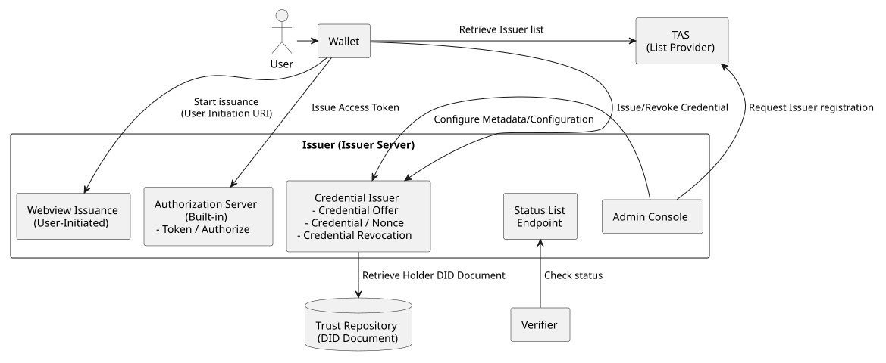
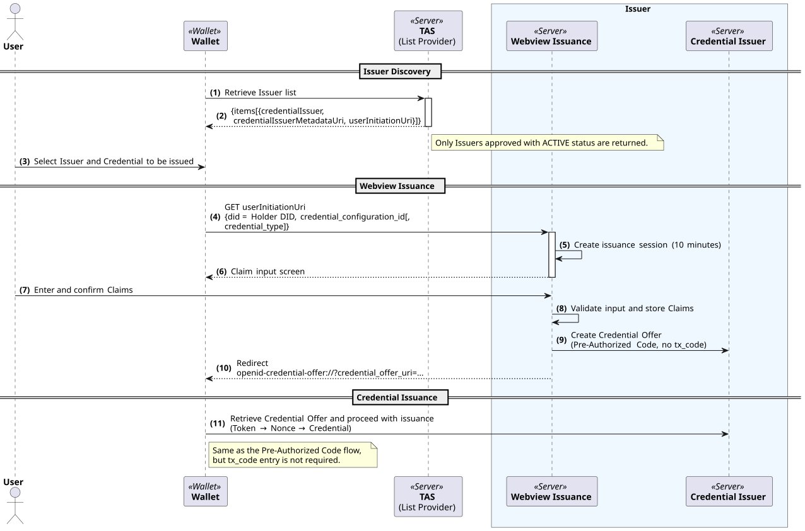
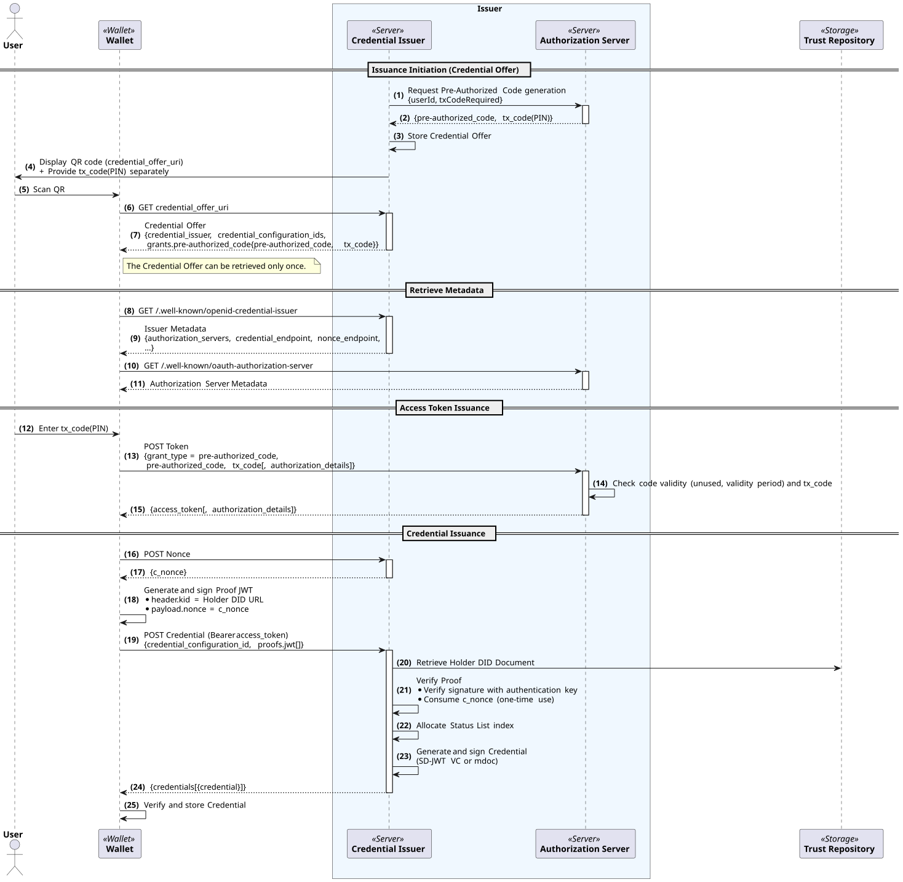
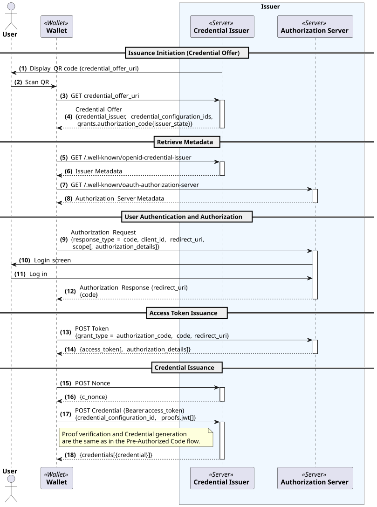
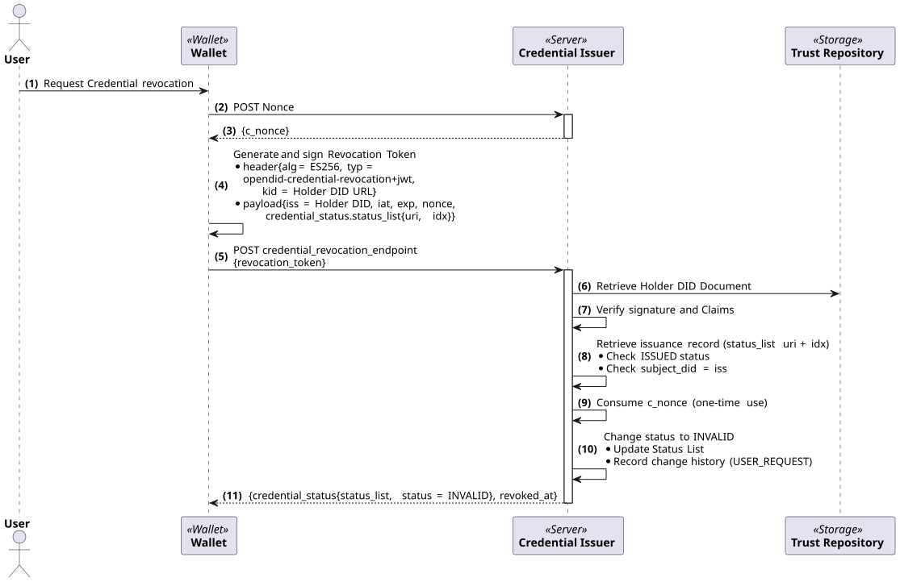

---
puppeteer:
    pdf:
        format: A4
        displayHeaderFooter: true
        landscape: false
        scale: 0.8
        margin:
            top: 1.2cm
            right: 1cm
            bottom: 1cm
            left: 1cm
    image:
        quality: 100
        fullPage: false
---

OID4VCI-based VC Issuance
==

- Subject: Explanation of OID4VCI-based VC Issuance Concept
- Author: OpenSource Development Team
- Date: 2026-10-21
- Version: v1.0.0

| Version | Date       | Changes         |
| ------- | ---------- | --------------- |
| v1.0.0  | 2026-10-21 | Initial version |

<br>

Table of Contents
---

<!-- TOC tocDepth:2..4 chapterDepth:2..6 -->

- [1. Overview](#1-overview)
    - [1.1. Reference Documents](#11-reference-documents)
    - [1.2. Terminology](#12-terminology)
    - [1.3. Comparison with the OpenDID Issuance Protocol](#13-comparison-with-the-opendid-issuance-protocol)
- [2. Components](#2-components)
- [3. Preliminary Procedures](#3-preliminary-procedures)
    - [3.1. Credential Configuration](#31-credential-configuration)
    - [3.2. Issuer Metadata](#32-issuer-metadata)
    - [3.3. Client Settings](#33-client-settings)
    - [3.4. List Provider Registration](#34-list-provider-registration)
- [4. Issuance Procedures](#4-issuance-procedures)
    - [4.1. Issuer-Initiated Issuance](#41-issuer-initiated-issuance)
    - [4.2. User-Initiated Issuance](#42-user-initiated-issuance)
    - [4.3. Pre-Authorized Code Flow](#43-pre-authorized-code-flow)
    - [4.4. Authorization Code Flow](#44-authorization-code-flow)
    - [4.5. Credential Request and Holder Binding](#45-credential-request-and-holder-binding)
    - [4.6. Credential Formats](#46-credential-formats)
- [5. Credential Status Management](#5-credential-status-management)
    - [5.1. Token Status List](#51-token-status-list)
    - [5.2. Status Transitions](#52-status-transitions)
    - [5.3. Status Change by Administrator](#53-status-change-by-administrator)
    - [5.4. Credential Revocation by Wallet](#54-credential-revocation-by-wallet)
    - [5.5. Status Check by Verifier](#55-status-check-by-verifier)
- [6. Implementation Scope and Constraints](#6-implementation-scope-and-constraints)

<!-- /TOC -->


<div style="page-break-after: always;"></div>

## 1. Overview

This document explains the overall concept of VC issuance based on OID4VCI (OpenID for Verifiable Credential Issuance) supported by OpenDID 3.0.
OpenDID supports OID4VCI issuance together with the existing OpenDID issuance protocol (P210, see [VC-ISSUANCE]),
and issues Credentials in SD-JWT VC and ISO mdoc formats via OID4VCI.

The OID4VCI-based VC issuance sequence is as follows:

1. Preliminary Procedures
    - (A) Register Credential Configuration - Define the format, identifiers, and Metadata of the Credential to be issued
    - (B) Issuer Metadata and Client settings - Endpoints, encryption support information, Authorization Server Client
    - (C) (Optional) Register with List Provider - Register the Issuer for user-initiated issuance
1. Issuance Procedures
    - (D) Initiation
        - (D1) Issuer initiated - Create and deliver Credential Offer (QR, etc.)
        - (D2) User initiated - Discover Issuer via List Provider, then issue via Webview
    - (E) Authorization
        - (E1) Pre-Authorized Code flow
        - (E2) Authorization Code flow
    - (F) Issuance
        - (F1) Request c_nonce - Nonce Endpoint
        - (F2) Generate Proof and request Credential - Credential Endpoint
1. Post-Issuance Management
    - (G) Status management - Status change based on Token Status List
    - (H) Credential revocation by wallet

### 1.1. Reference Documents

| Reference Name    | Document Name                                                 | Location |
| ----------------- | ------------------------------------------------------------- | -------- |
| [OID4VCI]         | OpenID for Verifiable Credential Issuance 1.0                 | https://openid.net/specs/openid-4-verifiable-credential-issuance-1_0.html |
| [RFC6749]         | The OAuth 2.0 Authorization Framework                         | https://www.rfc-editor.org/rfc/rfc6749 |
| [SD-JWT-VC]       | SD-JWT-based Verifiable Credentials (SD-JWT VC)               | https://datatracker.ietf.org/doc/draft-ietf-oauth-sd-jwt-vc/ |
| [TOKEN-STATUS]    | Token Status List                                             | https://datatracker.ietf.org/doc/draft-ietf-oauth-status-list/ |
| [ISO-18013-5]     | ISO/IEC 18013-5 Mobile driving licence (mDL) application      |          |
| [VC-ISSUANCE]     | (OpenDID) VC Issuance                                         | [VC Issuance.md](VC%20Issuance.md) |
| [DID-DOC-FORMAT]  | (OpenDID) DID Document format                                 | [DID Document format.md](../data%20standard/did%20document%20format/DID%20Document%20format.md) |
| [ISSUER-API]      | (OpenDID) Issuer API                                          | did-issuer-server `docs/api/Issuer_API.md` |
| [OID4VCI-SDK]     | (OpenDID) OID4VCI SDK Server API / Integration Guide          | did-oid4vci-sdk-server `docs/api/` |

### 1.2. Terminology

| Term | Description |
| ---- | ----------- |
| Credential Issuer | The entity that issues OID4VCI Credentials. In OpenDID, the Issuer server performs this role. |
| Authorization Server | The OAuth 2.0 authorization server that issues Access Tokens. It is built into the OpenDID Issuer server. |
| Credential Offer | Information that the Credential Issuer delivers to the wallet to initiate issuance. It contains the Credential to be issued and the authorization method (grant). |
| Credential Configuration | A configuration that defines the format, identifier, display information, etc. of the Credential to be issued. It is published through `credential_configurations_supported` in the Issuer Metadata. |
| Pre-Authorized Code | A one-time authorization code issued by the Credential Issuer after user authentication has been completed in advance |
| tx_code | A transaction code (PIN) used together with the Pre-Authorized Code. It is delivered to the user through a separate channel. |
| c_nonce | A one-time nonce issued by the Credential Issuer to prevent reuse of the Proof in a Credential request |
| Proof | A JWT signed by the wallet with the Holder key to prove possession of the key |
| Token Status List | A list that publishes the status of Credentials as a bit array ([TOKEN-STATUS]) |
| List Provider | A provider that manages the list of OID4VCI Issuers and provides it to wallets. In OpenDID, TAS performs this role. |

### 1.3. Comparison with the OpenDID Issuance Protocol

| Category | OpenDID Issuance Protocol (P210) | OID4VCI-based Issuance |
| -------- | -------------------------------- | ---------------------- |
| Issuance initiation | Issue Offer, VC Plan retrieval | Credential Offer, Issuer list of the List Provider |
| Relay | Via TAS (or Proxy) | The wallet requests the Issuer directly |
| Authorization | Server token, DID Auth | OAuth 2.0 Access Token (Pre-Authorized Code / Authorization Code) |
| Secure channel | ECDH and E2E encryption | TLS, (optional) JWE encryption of the Credential response |
| Holder binding | DID Auth signature | Proof JWT (`kid` = Holder DID URL) |
| Credential format | OpenDID VC (JSON-LD), ZKP Credential | SD-JWT VC, ISO mdoc |
| Status management | VC Meta in the Trust Repository | Token Status List |


<div style="page-break-after: always;"></div>

## 2. Components

The components of OID4VCI-based issuance are shown in the diagram below.



| Component | Role |
| --------- | ---- |
| Wallet | Receives the Credential Offer, requests an Access Token and a Credential, and stores the issued Credential. Signs the Proof and the revocation token with the Holder DID key. |
| Credential Issuer | Provides the Credential Offer, Nonce, Credential, and Credential revocation Endpoints and the Issuer Metadata (`/.well-known/openid-credential-issuer`). |
| Authorization Server | Issues Access Tokens through the Pre-Authorized Code and Authorization Code grants. It is built into the Issuer server. |
| Status List Endpoint | Publishes the signed Token Status List (`application/statuslist+jwt`). |
| Webview Issuance | Provides the Claim input screen in user-initiated issuance and creates the Credential Offer. |
| Admin Console | Manages the Issuer Metadata, Credential Configuration, Client settings, List Provider registration, and issuance history and status. |
| TAS (List Provider) | Approves and manages registered OID4VCI Issuers, and provides the Issuer list to wallets. |
| Trust Repository | Provides the Holder DID Document. The Credential Issuer checks the signing key of the Proof and the revocation token against `authentication` in the Holder DID Document. |
| Verifier | Checks the Credential status using the Status List URI included in the Credential. |


<div style="page-break-after: always;"></div>

## 3. Preliminary Procedures

### 3.1. Credential Configuration

**Credential Configuration** is the definition of the Credential to be issued and includes the following information.

| Item | Description |
| ---- | ----------- |
| Configuration ID | Unique identifier of the Credential Configuration. Used in `credential_configuration_ids` of the Credential Offer and in the Credential request. |
| Format | Credential format. One of `dc+sd-jwt-did` and `mso_mdoc-did` (see [4.6](#46-credential-formats)) |
| Identifiers | Values that identify the type of Credential to be issued. Delivered as `authorization_details.credential_identifiers` in the Access Token response. |
| Metadata | JSON to be published in `credential_configurations_supported` of the Issuer Metadata. Includes `vct` for SD-JWT VC or `doctype` for mdoc, together with Claim display information and the supported Proof types (`jwt`, ES256). |

Credential Configurations are registered in the Admin Console, and only activated Configurations are published in the Issuer Metadata.

### 3.2. Issuer Metadata

The wallet retrieves the Issuer Metadata from `{credential_issuer}/.well-known/openid-credential-issuer` to identify the Endpoints required for issuance.

| Item | Description |
| ---- | ----------- |
| `credential_issuer` | Credential Issuer identifier (URL) |
| `authorization_servers` | List of Authorization Server URLs |
| `credential_offer_endpoint` | Credential Offer retrieval Endpoint |
| `credential_endpoint` | Credential issuance Endpoint |
| `nonce_endpoint` | c_nonce issuance Endpoint |
| `credential_revocation_endpoint` | (OpenDID extension) Endpoint for Credential revocation by the wallet. It is always `{credential_issuer}/credential-lifecycle/revoke`. |
| `deferred_credential_endpoint`, `notification_endpoint` | Deferred issuance and issuance result notification Endpoints (see [6](#6-implementation-scope-and-constraints)) |
| `credential_request_encryption`, `credential_response_encryption` | Credential request/response encryption support information |
| `credential_configurations_supported` | List of activated Credential Configurations |

Issuance Endpoints such as the Credential Offer, Credential, Nonce, and revocation Endpoints are determined based on the Credential Issuer URL. In the Admin Console, the Credential Issuer URL, the Authorization Server, and the encryption support information are configured.

### 3.3. Client Settings

An OAuth 2.0 Client used by the wallet must be registered with the Authorization Server.
The Client ID, Client Secret, and Redirect URL are set in the Client settings of the Admin Console, and a registered Client can use the following grants.

- `authorization_code`, `refresh_token`
- `urn:ietf:params:oauth:grant-type:pre-authorized_code`

When requesting an Access Token with a Pre-Authorized Code, the request can be made without Client authentication (public client).

### 3.4. List Provider Registration

To support user-initiated issuance, the Issuer must be registered with the List Provider (TAS).
The Issuer requests registration with the following information, and once the TAS administrator approves it, the Issuer is shown in the wallet's Issuer list.

| Item | Description |
| ---- | ----------- |
| `credentialIssuer` | Credential Issuer identifier. A DID or an http(s) URL can be used, and the OpenDID Issuer server uses the Issuer DID. |
| `credentialIssuerMetadataUri` | Issuer Metadata URI. Required if `credentialIssuer` is a DID. |
| `userInitiationUri` | URI that starts user-initiated issuance (Webview issuance screen) |

An Issuer registered with the List Provider has the following statuses.

| Status | Description | Next Status |
| ------ | ----------- | ----------- |
| `REQUESTED` | Registration requested | `ACTIVE`, `REJECTED` |
| `ACTIVE` | Approved. Shown in the wallet's Issuer list. | `SUSPENDED`, `REVOKED` |
| `SUSPENDED` | Temporarily suspended | `ACTIVE`, `REVOKED` |
| `REJECTED` | Rejected | - |
| `REVOKED` | Registration revoked | - |

When changing the status to `REJECTED`, `SUSPENDED`, or `REVOKED`, the reason is recorded together.


<div style="page-break-after: always;"></div>

## 4. Issuance Procedures

OID4VCI issuance is classified into issuer-initiated issuance and user-initiated issuance according to how issuance is initiated,
and into the Pre-Authorized Code flow and the Authorization Code flow according to how the Access Token is obtained.

| Initiation Method | Authorization Method | tx_code |
| ----------------- | -------------------- | ------- |
| Initiated by the Issuer (Credential Offer QR) | Pre-Authorized Code or Authorization Code | Used for Pre-Authorized Code |
| Initiated by the user (Webview) | Pre-Authorized Code | Not used |

### 4.1. Issuer-Initiated Issuance

The Credential Issuer creates a **Credential Offer** by specifying the target user and the Credential Configuration,
and delivers it to the wallet via a QR code or similar means. A Credential Offer can be delivered either as the value itself (by value) or as a retrieval URI (by reference),
and OpenDID delivers the retrieval URI by default.

```
openid-credential-offer://?credential_offer_uri={credential_issuer}/credential-offer/{request_id}/{configuration_id}
```

The Credential Offer contains the following information.

```json
{
  "credential_issuer": "https://issuer.example.com",
  "credential_configuration_ids": ["VerifiableIdSD"],
  "grants": {
    "urn:ietf:params:oauth:grant-type:pre-authorized_code": {
      "pre-authorized_code": "...",
      "tx_code": { "input_mode": "numeric", "length": 6, "description": "..." }
    }
  }
}
```

- A Credential Offer for the Pre-Authorized Code flow can be retrieved only once.
- The Pre-Authorized Code is valid for 10 minutes, and the tx_code (6-digit PIN) is provided to the user through a channel separate from the QR code.
- A Credential Offer for the Authorization Code flow includes `grants.authorization_code.issuer_state`.

### 4.2. User-Initiated Issuance

In this method, the user directly selects the Issuer and the Credential to be issued in the wallet and initiates issuance.



1. The wallet retrieves the list of approved (`ACTIVE`) Issuers from the List Provider (TAS).
1. When the user selects an Issuer and a Credential, the wallet opens the Issuer's `userInitiationUri` in a Webview. At this time, it passes the Holder DID and the Credential Configuration ID.
1. The Issuer creates an issuance session (valid for 10 minutes) and provides an input screen according to the Claim definitions of the Credential Configuration.
1. When the user enters and confirms the Claims, the Issuer validates and stores the input values, and creates a Pre-Authorized Code Credential Offer without a tx_code.
1. The Issuer redirects to the `openid-credential-offer://` URI, and the wallet receives the Credential through the flow in [4.3](#43-pre-authorized-code-flow).

### 4.3. Pre-Authorized Code Flow

In this flow, the Credential Issuer issues a Pre-Authorized Code after verifying the user in advance.



1. The Credential Issuer requests a Pre-Authorized Code (and a tx_code if needed) from the Authorization Server and creates a Credential Offer.
1. The wallet retrieves the Credential Offer, and then retrieves the Issuer Metadata and the Authorization Server Metadata.
1. The wallet requests an Access Token with the Pre-Authorized Code and the tx_code entered by the user. The Authorization Server checks whether the code has been used, its validity period, and the tx_code, then consumes the code and issues an Access Token.
1. The wallet receives a c_nonce from the Nonce Endpoint, creates a Proof JWT containing the c_nonce, and requests the Credential (see [4.5](#45-credential-request-and-holder-binding)).
1. The Credential Issuer verifies the Proof, generates the Credential, and responds.

### 4.4. Authorization Code Flow

In this flow, the wallet obtains an Access Token through user authentication and authorization at the Authorization Server.



1. The wallet retrieves the Credential Offer and the Metadata.
1. The wallet sends an authorization request to the Authorization Server, and the user logs in.
1. The Authorization Server delivers the authorization code to the registered Redirect URI.
1. The wallet requests an Access Token with the authorization code.
1. The subsequent c_nonce request and Credential request are the same as in the Pre-Authorized Code flow.

### 4.5. Credential Request and Holder Binding

The wallet requests the Credential together with the Access Token, and the request includes a Proof JWT that proves possession of the Holder key.

```json
{
  "credential_configuration_id": "VerifiableIdSD",
  "proofs": {
    "jwt": ["<Proof JWT>"]
  }
}
```

**Proof JWT Rules**

| Item | Rule |
| ---- | ---- |
| Key identification | Use only one key identifier in the Header; the OpenDID wallet uses the Holder DID URL `kid`. |
| `kid` | Holder DID URL (including the key fragment, e.g., `did:omn:holder?versionId=1#pin`; the key name is `#pin` or `#bio`). The Credential Issuer retrieves the Holder DID Document and verifies the signature with the P-256 key registered in `authentication`. |
| Holder | All Proofs included in a single request must use the same Holder DID. |
| `nonce` | The c_nonce received from the Nonce Endpoint. A c_nonce is valid for 10 minutes and can be used only once. |
| Formats with status management | SD-JWT VC and mdoc require a Proof identified by a Holder DID `kid`. |

The Credential Issuer stores the verified Holder DID in the issuance record, and this value is used to verify Credential revocation requests from the wallet (see [5.4](#54-credential-revocation-by-wallet)).
The public key of the Proof is included in the Credential as the Holder binding key (`cnf` for SD-JWT VC, Device Key for mdoc).

**Credential Response Encryption**

If `credential_response_encryption.encryption_required` in the Issuer Metadata is `true`, the wallet must include a public key for response encryption (`credential_response_encryption{jwk, alg, enc}`) in the Credential request,
and the Credential Issuer encrypts the Credential response as a JWE and returns it. The OpenDID wallet uses `ECDH-ES` (EC keys) and `A256GCM`. If the request has no `alg`, the Credential Issuer chooses an algorithm from `alg_values_supported` in the Issuer Metadata, so the Metadata lists `ECDH-ES` only.

### 4.6. Credential Formats

| Format | Credential | Issuer Key Identification | Remarks |
| ------ | ---------- | ------------------------- | ------- |
| `dc+sd-jwt-did` | SD-JWT VC | Issuer DID URL (`kid`) | JWT Header `typ: dc+sd-jwt-did` |
| `mso_mdoc-did` | ISO mdoc | IssuerAuth signed with the Issuer DID URL | |

- Credentials are signed with the key of the Issuer DID Document registered in the OpenDID Trust Repository, so the wallet and the verifier verify the signature with the Issuer DID Document.
- The type of an SD-JWT VC is expressed as `vct` and the type of an mdoc as `doctype`, and both are taken from the Metadata of the Credential Configuration.
- A Credential to which status management applies includes a Status List reference (`status.status_list{uri, idx}`). For SD-JWT VC, it is included as a Claim signed by the Issuer, and for mdoc, it is included in the MSO.


<div style="page-break-after: always;"></div>

## 5. Credential Status Management

### 5.1. Token Status List

OpenDID manages the status of SD-JWT VCs and mdocs issued via OID4VCI with [TOKEN-STATUS].

- The Credential Issuer creates a Status List for each Credential format, and allocates a Status List index when issuing a Credential.
- The Credential includes the Status List URI (`{Issuer base URL}/status-lists/{listId}`) and the index.
- The Status List Endpoint provides the Status List as a JWT signed with the Issuer DID key (`typ: statuslist+jwt`, `application/statuslist+jwt`).
    - Claims: `sub` (Status List URI), `iat`, `exp`, `ttl`, `status_list{bits, lst}`
    - `lst` is the status bit array compressed (zlib) and encoded in base64url.

| Status | Value | Description |
| ------ | ----- | ----------- |
| `VALID` | 0 | Valid |
| `INVALID` | 1 | Revoked. Cannot be made valid again. |
| `SUSPENDED` | 2 | Temporarily suspended |

### 5.2. Status Transitions


| Current Status | Allowed Next Status |
| -------------- | ------------------- |
| `VALID` | `SUSPENDED`, `INVALID` |
| `SUSPENDED` | `VALID`, `INVALID` |
| `INVALID` | (Cannot be changed) |

When the status is changed, the value at the corresponding index of the Status List and the Status List version are updated, and the reason for the change and the person who made the change are recorded in the history.

### 5.3. Status Change by Administrator

The Issuer administrator selects an issued Credential in the issuance history (OID4VCI Credentials) of the Admin Console and changes its status.
A reason must be entered when changing the status.

### 5.4. Credential Revocation by Wallet

The wallet can directly request the Issuer to revoke a Credential it holds. This feature is an OpenDID extension to OID4VCI, and it identifies the requester by a Holder DID signature without using an Access Token or TAS.



1. The wallet receives a c_nonce from the Nonce Endpoint.
1. The wallet signs, with the Holder DID key, a revocation token (Revocation Token) containing the Status List URI and index of the Credential to be revoked and the c_nonce.

    | Part | Item | Description |
    | ---- | ---- | ----------- |
    | Header | `alg` | `ES256` |
    | Header | `typ` | `opendid-credential-revocation+jwt` |
    | Header | `kid` | Holder DID URL. The DID part must be the same as `iss`. |
    | Payload | `iss` | Holder DID |
    | Payload | `iat`, `exp` | Issued-at and expiration time. `exp` must be within 5 minutes after `iat` |
    | Payload | `nonce` | c_nonce |
    | Payload | `credential_status.status_list` | `{uri, idx}` of the Credential to be revoked |

1. The wallet sends the revocation token to the `credential_revocation_endpoint` in the Issuer Metadata.
1. The Credential Issuer verifies the signature and the Claims, and checks whether the Holder DID of the issuance record found by the Status List URI and index is the same as `iss`.
1. The Credential Issuer consumes the c_nonce, changes the status to `INVALID`, and responds with the changed status and the revocation time. For a Credential that is already `INVALID`, it responds with success without adding history.

Refer to [ISSUER-API] for the request and response formats and error codes.

### 5.5. Status Check by Verifier

The verifier retrieves the Status List using the Status List URI included in the Credential, verifies the signature with the Issuer DID key, and then checks the status value corresponding to the index of the Credential.
The Status List can be cached according to `ttl` and `Cache-Control` in the Status List response.

> **Note**: This section describes the behavior of the verifier according to [TOKEN-STATUS]. For the Status List check function of the OpenDID Verifier server, refer to a separate document.


<div style="page-break-after: always;"></div>

## 6. Implementation Scope and Constraints

The OID4VCI implementation of OpenDID 3.0 is limited to the following scope.

| Item | Current Behavior |
| ---- | ---------------- |
| Deferred issuance (Deferred Credential) | Not supported. The Endpoint is published in the Metadata, but all Credentials are issued immediately. |
| Issuance result notification (Notification) | Requests are received and only recorded, and `notification_id` is not issued. |
| Credential request encryption | The support information is published in the Metadata, but encrypted requests are not processed. |
| Batch issuance (Batch) | `batch_credential_issuance` is not published. If a single request includes multiple Proofs, one Credential is issued for each Proof key. |
| Proof type | Only the signature of a `jwt` Proof is verified. |
| Authorization Server | PAR (Pushed Authorization Request) and OpenID Connect are not supported. |
| Authorization method for user-initiated issuance | Only the Pre-Authorized Code is used. |
