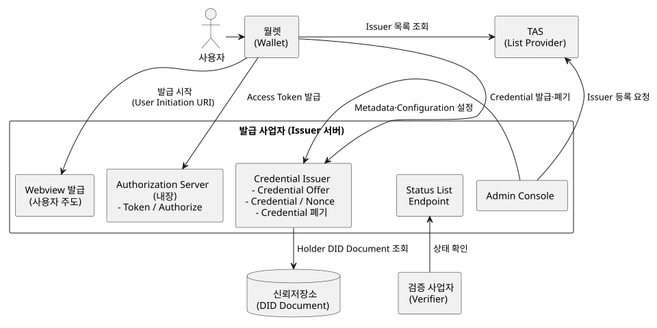
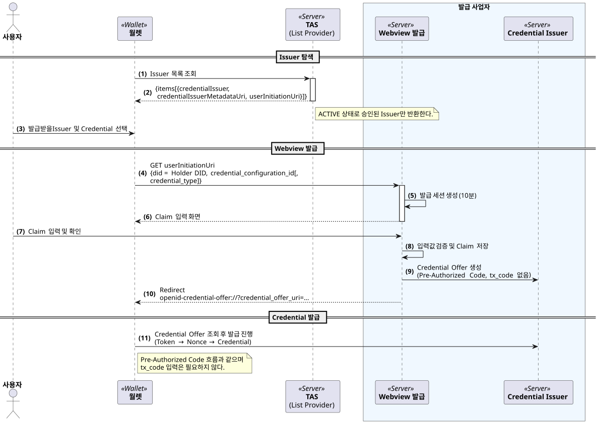
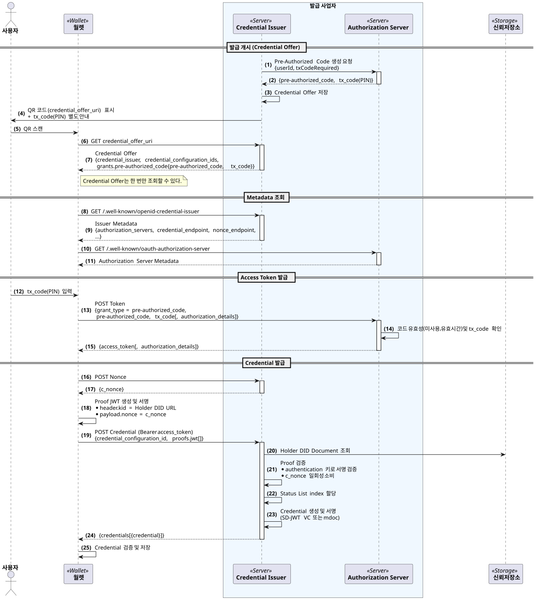
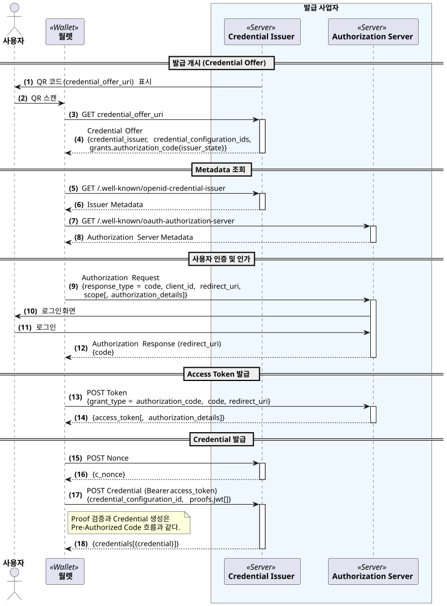
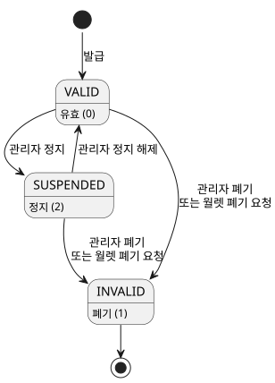
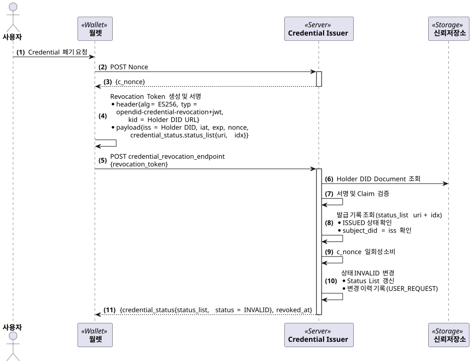

---
puppeteer:
    pdf:
        format: A4
        displayHeaderFooter: true
        landscape: false
        scale: 0.8
        margin:
            top: 1.2cm
            right: 1cm
            bottom: 1cm
            left: 1cm
    image:
        quality: 100
        fullPage: false
---

OID4VCI 기반 VC 발급
==

- 주제 : OID4VCI 기반 VC 발급의 개념 설명
- 작성 : 오픈소스개발팀
- 일자 : 2026-10-21
- 버전 : v1.0.0

| 버전 | 일자       | 변경         |
| ------- | ---------- | --------------- |
| v1.0.0  | 2026-10-21 | 최초 작성 |

<br>

목차
---

<!-- TOC tocDepth:2..4 chapterDepth:2..6 -->

- [1. 개요](#1-개요)
    - [1.1. 참조문서](#11-참조문서)
    - [1.2. 용어](#12-용어)
    - [1.3. OpenDID 발급 프로토콜과의 비교](#13-opendid-발급-프로토콜과의-비교)
- [2. 구성 요소](#2-구성-요소)
- [3. 사전준비 절차](#3-사전준비-절차)
    - [3.1. Credential Configuration](#31-credential-configuration)
    - [3.2. Issuer Metadata](#32-issuer-metadata)
    - [3.3. Client 설정](#33-client-설정)
    - [3.4. List Provider 등록](#34-list-provider-등록)
- [4. 발급 절차](#4-발급-절차)
    - [4.1. 이슈어에 의한 발급 개시](#41-이슈어에-의한-발급-개시)
    - [4.2. 사용자에 의한 발급 개시](#42-사용자에-의한-발급-개시)
    - [4.3. Pre-Authorized Code 흐름](#43-pre-authorized-code-흐름)
    - [4.4. Authorization Code 흐름](#44-authorization-code-흐름)
    - [4.5. Credential 요청과 Holder 바인딩](#45-credential-요청과-holder-바인딩)
    - [4.6. Credential 형식](#46-credential-형식)
- [5. Credential 상태 관리](#5-credential-상태-관리)
    - [5.1. Token Status List](#51-token-status-list)
    - [5.2. 상태 전이](#52-상태-전이)
    - [5.3. 관리자에 의한 상태 변경](#53-관리자에-의한-상태-변경)
    - [5.4. 월렛에 의한 Credential 폐기](#54-월렛에-의한-credential-폐기)
    - [5.5. 검증자의 상태 확인](#55-검증자의-상태-확인)
- [6. 구현 범위 및 제약](#6-구현-범위-및-제약)

<!-- /TOC -->


<div style="page-break-after: always;"></div>

## 1. 개요

본 문서는 OpenDID 3.0에서 지원하는 OID4VCI(OpenID for Verifiable Credential Issuance) 기반 VC 발급의 전반적인 개념을 설명한다.
OpenDID는 기존 OpenDID 발급 프로토콜(P210, [VC-ISSUANCE] 참조)과 함께 OID4VCI 발급을 지원하며,
OID4VCI로는 SD-JWT VC와 ISO mdoc 형식의 Credential을 발급한다.

OID4VCI 기반 VC 발급 순서는 다음과 같다.

1. 사전준비 절차
    - (A) Credential Configuration 등록 - 발급할 Credential의 형식, 식별자, Metadata 정의
    - (B) Issuer Metadata 및 Client 설정 - Endpoint, 암호화 지원 정보, Authorization Server Client
    - (C) (Optional) List Provider 등록 - 사용자 주도 발급을 위한 Issuer 등록
1. 발급 절차
    - (D) 개시 단계 (Initiation)
        - (D1) Issuer initiated - Credential Offer 생성 및 전달 (QR 등)
        - (D2) User initiated - List Provider에서 Issuer 탐색 후 Webview 발급
    - (E) 인가 단계 (Authorization)
        - (E1) Pre-Authorized Code 흐름
        - (E2) Authorization Code 흐름
    - (F) 발급 단계 (Issuance)
        - (F1) c_nonce 요청 - Nonce Endpoint
        - (F2) Proof 생성 및 Credential 요청 - Credential Endpoint
1. 사후 관리
    - (G) 상태 관리 - Token Status List 기반 상태 변경
    - (H) 월렛에 의한 Credential 폐기

### 1.1. 참조문서

| 참조명            | 문서명                                                        | 위치 |
| ----------------- | ------------------------------------------------------------- | ---- |
| [OID4VCI]         | OpenID for Verifiable Credential Issuance 1.0                 | https://openid.net/specs/openid-4-verifiable-credential-issuance-1_0.html |
| [RFC6749]         | The OAuth 2.0 Authorization Framework                         | https://www.rfc-editor.org/rfc/rfc6749 |
| [SD-JWT-VC]       | SD-JWT-based Verifiable Credentials (SD-JWT VC)               | https://datatracker.ietf.org/doc/draft-ietf-oauth-sd-jwt-vc/ |
| [TOKEN-STATUS]    | Token Status List                                             | https://datatracker.ietf.org/doc/draft-ietf-oauth-status-list/ |
| [ISO-18013-5]     | ISO/IEC 18013-5 Mobile driving licence (mDL) application      |      |
| [VC-ISSUANCE]     | (OpenDID) VC 발급                                             | [VC Issuance_ko.md](VC%20Issuance_ko.md) |
| [DID-DOC-FORMAT]  | (OpenDID) DID Document format                                 | [DID Document format_ko.md](../data%20standard/did%20document%20format/DID%20Document%20format_ko.md) |
| [ISSUER-API]      | (OpenDID) Issuer API                                          | did-issuer-server `docs/api/Issuer_API_ko.md` |
| [OID4VCI-SDK]     | (OpenDID) OID4VCI SDK Server API / Integration Guide          | did-oid4vci-sdk-server `docs/api/` |

### 1.2. 용어

| 용어 | 설명 |
| ---- | ---- |
| Credential Issuer | OID4VCI Credential을 발급하는 주체. OpenDID에서는 Issuer 서버가 수행한다. |
| Authorization Server | Access Token을 발급하는 OAuth 2.0 인가 서버. OpenDID Issuer 서버에 내장되어 있다. |
| Credential Offer | 발급을 개시하기 위해 Credential Issuer가 월렛에 전달하는 정보. 발급할 Credential과 인가 방식(grant)을 담는다. |
| Credential Configuration | 발급할 Credential의 형식, 식별자, 표시 정보 등을 정의한 설정. Issuer Metadata의 `credential_configurations_supported`로 공개된다. |
| Pre-Authorized Code | Credential Issuer가 사용자 인증을 미리 완료한 상태에서 발급하는 일회용 인가 코드 |
| tx_code | Pre-Authorized Code와 함께 사용하는 거래 코드(PIN). 별도 채널로 사용자에게 전달된다. |
| c_nonce | Credential 요청 Proof의 재사용을 막기 위해 Credential Issuer가 발급하는 일회용 nonce |
| Proof | 월렛이 Holder 키로 서명하여 키 소유를 증명하는 JWT |
| Token Status List | Credential 상태를 비트 배열로 공개하는 목록 ([TOKEN-STATUS]) |
| List Provider | OID4VCI Issuer 목록을 관리하고 월렛에 제공하는 사업자. OpenDID에서는 TAS가 수행한다. |

### 1.3. OpenDID 발급 프로토콜과의 비교

| 구분 | OpenDID 발급 프로토콜 (P210) | OID4VCI 기반 발급 |
| ---- | --------------------------- | ----------------- |
| 발급 개시 | Issue Offer, VC Plan 조회 | Credential Offer, List Provider의 Issuer 목록 |
| 중계 | TAS(또는 Proxy)를 경유 | 월렛이 Issuer에 직접 요청 |
| 인가 | 서버토큰, DID Auth | OAuth 2.0 Access Token (Pre-Authorized Code / Authorization Code) |
| 보안 채널 | ECDH 및 E2E 암호화 | TLS, (선택) Credential 응답 JWE 암호화 |
| Holder 바인딩 | DID Auth 서명 | Proof JWT (`kid` = Holder DID URL) |
| Credential 형식 | OpenDID VC (JSON-LD), ZKP Credential | SD-JWT VC, ISO mdoc |
| 상태 관리 | 신뢰저장소의 VC Meta | Token Status List |


<div style="page-break-after: always;"></div>

## 2. 구성 요소

OID4VCI 기반 발급의 구성 요소는 아래 그림과 같다.



| 구성 요소 | 역할 |
| --------- | ---- |
| 월렛 | Credential Offer를 받아 Access Token과 Credential을 요청하고, 발급된 Credential을 저장한다. Holder DID 키로 Proof와 폐기 토큰에 서명한다. |
| Credential Issuer | Credential Offer, Nonce, Credential, Credential 폐기 Endpoint와 Issuer Metadata(`/.well-known/openid-credential-issuer`)를 제공한다. |
| Authorization Server | Pre-Authorized Code와 Authorization Code grant로 Access Token을 발급한다. Issuer 서버에 내장되어 있다. |
| Status List Endpoint | 서명된 Token Status List(`application/statuslist+jwt`)를 공개한다. |
| Webview 발급 | 사용자 주도 발급에서 Claim 입력 화면을 제공하고 Credential Offer를 생성한다. |
| Admin Console | Issuer Metadata, Credential Configuration, Client 설정, List Provider 등록, 발급 이력 및 상태를 관리한다. |
| TAS (List Provider) | 등록된 OID4VCI Issuer를 승인·관리하고, 월렛에 Issuer 목록을 제공한다. |
| 신뢰저장소 | Holder DID Document를 제공한다. Credential Issuer는 Proof와 폐기 토큰의 서명 키를 Holder DID Document의 `authentication`에서 확인한다. |
| 검증 사업자 | Credential에 포함된 Status List URI로 Credential 상태를 확인한다. |


<div style="page-break-after: always;"></div>

## 3. 사전준비 절차

### 3.1. Credential Configuration

**Credential Configuration**은 발급할 Credential의 정의로서 다음 정보를 포함한다.

| 항목 | 설명 |
| ---- | ---- |
| Configuration ID | Credential Configuration의 고유 식별자. Credential Offer의 `credential_configuration_ids`와 Credential 요청에서 사용한다. |
| Format | Credential 형식. `dc+sd-jwt-did`, `mso_mdoc-did` 중 하나 ([4.6](#46-credential-형식) 참조) |
| Identifiers | 발급할 Credential 유형을 식별하는 값. Access Token 응답의 `authorization_details.credential_identifiers`로 전달된다. |
| Metadata | Issuer Metadata의 `credential_configurations_supported`에 공개할 JSON. SD-JWT VC는 `vct`, mdoc은 `doctype`과 Claim 표시 정보, 지원 Proof 유형(`jwt`, ES256)을 포함한다. |

Credential Configuration은 Admin Console에서 등록하며, 활성화된 Configuration만 Issuer Metadata에 공개된다.

### 3.2. Issuer Metadata

월렛은 `{credential_issuer}/.well-known/openid-credential-issuer`에서 Issuer Metadata를 조회하여 발급에 필요한 Endpoint를 확인한다.

| 항목 | 설명 |
| ---- | ---- |
| `credential_issuer` | Credential Issuer 식별자(URL) |
| `authorization_servers` | Authorization Server URL 목록 |
| `credential_offer_endpoint` | Credential Offer 조회 Endpoint |
| `credential_endpoint` | Credential 발급 Endpoint |
| `nonce_endpoint` | c_nonce 발급 Endpoint |
| `credential_revocation_endpoint` | (OpenDID 확장) 월렛에 의한 Credential 폐기 Endpoint. 항상 `{credential_issuer}/credential-lifecycle/revoke`이다. |
| `deferred_credential_endpoint`, `notification_endpoint` | 지연 발급, 발급 결과 알림 Endpoint ([6](#6-구현-범위-및-제약) 참조) |
| `credential_request_encryption`, `credential_response_encryption` | Credential 요청·응답 암호화 지원 정보 |
| `credential_configurations_supported` | 활성화된 Credential Configuration 목록 |

Credential Offer, Credential, Nonce, 폐기 Endpoint 등 발급 Endpoint는 Credential Issuer URL을 기준으로 정해지며, Admin Console에서는 Credential Issuer URL과 Authorization Server, 암호화 지원 정보를 설정한다.

### 3.3. Client 설정

Authorization Server에는 월렛이 사용하는 OAuth 2.0 Client가 등록되어야 한다.
Admin Console의 Client 설정에서 Client ID, Client Secret, Redirect URL을 설정하며, 등록된 Client는 다음 grant를 사용할 수 있다.

- `authorization_code`, `refresh_token`
- `urn:ietf:params:oauth:grant-type:pre-authorized_code`

Pre-Authorized Code로 Access Token을 요청할 때는 Client 인증 없이(public client) 요청할 수 있다.

### 3.4. List Provider 등록

사용자 주도 발급을 지원하려면 Issuer를 List Provider(TAS)에 등록해야 한다.
Issuer는 다음 정보로 등록을 요청하며, TAS 관리자가 승인하면 월렛의 Issuer 목록에 노출된다.

| 항목 | 설명 |
| ---- | ---- |
| `credentialIssuer` | Credential Issuer 식별자. DID 또는 http(s) URL을 사용할 수 있으며, OpenDID Issuer 서버는 Issuer DID를 사용한다. |
| `credentialIssuerMetadataUri` | Issuer Metadata URI. `credentialIssuer`가 DID인 경우 필수이다. |
| `userInitiationUri` | 사용자 주도 발급을 시작하는 URI (Webview 발급 화면) |

List Provider에 등록된 Issuer는 다음 상태를 가진다.

| 상태 | 설명 | 다음 상태 |
| ---- | ---- | --------- |
| `REQUESTED` | 등록 요청됨 | `ACTIVE`, `REJECTED` |
| `ACTIVE` | 승인됨. 월렛의 Issuer 목록에 노출된다. | `SUSPENDED`, `REVOKED` |
| `SUSPENDED` | 일시 정지됨 | `ACTIVE`, `REVOKED` |
| `REJECTED` | 반려됨 | - |
| `REVOKED` | 등록 취소됨 | - |

`REJECTED`, `SUSPENDED`, `REVOKED`로 변경할 때는 사유를 함께 기록한다.


<div style="page-break-after: always;"></div>

## 4. 발급 절차

OID4VCI 발급은 발급 개시 방식에 따라 이슈어에 의한 발급 개시와 사용자에 의한 발급 개시로 구분하고,
Access Token을 얻는 방식에 따라 Pre-Authorized Code 흐름과 Authorization Code 흐름으로 구분한다.

| 개시 방식 | 인가 방식 | tx_code |
| --------- | --------- | ------- |
| 이슈어에 의한 개시 (Credential Offer QR) | Pre-Authorized Code 또는 Authorization Code | Pre-Authorized Code인 경우 사용 |
| 사용자에 의한 개시 (Webview) | Pre-Authorized Code | 사용하지 않음 |

### 4.1. 이슈어에 의한 발급 개시

Credential Issuer는 발급 대상 사용자와 Credential Configuration을 지정하여 **Credential Offer**를 생성하고,
QR 코드 등으로 월렛에 전달한다. Credential Offer는 값 자체를 전달하는 방식(by value)과 조회 URI를 전달하는 방식(by reference)이 있으며,
OpenDID는 기본적으로 조회 URI를 전달한다.

```
openid-credential-offer://?credential_offer_uri={credential_issuer}/credential-offer/{request_id}/{configuration_id}
```

Credential Offer는 다음 정보를 포함한다.

```json
{
  "credential_issuer": "https://issuer.example.com",
  "credential_configuration_ids": ["VerifiableIdSD"],
  "grants": {
    "urn:ietf:params:oauth:grant-type:pre-authorized_code": {
      "pre-authorized_code": "...",
      "tx_code": { "input_mode": "numeric", "length": 6, "description": "..." }
    }
  }
}
```

- Pre-Authorized Code 흐름의 Credential Offer는 한 번만 조회할 수 있다.
- Pre-Authorized Code는 10분 동안 유효하며, tx_code(6자리 PIN)는 QR과 별도의 채널로 사용자에게 안내한다.
- Authorization Code 흐름의 Credential Offer는 `grants.authorization_code.issuer_state`를 포함한다.

### 4.2. 사용자에 의한 발급 개시

사용자가 월렛에서 발급받을 Issuer와 Credential을 직접 선택하여 발급을 시작하는 방식이다.



1. 월렛은 List Provider(TAS)에서 승인된(`ACTIVE`) Issuer 목록을 조회한다.
1. 사용자가 Issuer와 Credential을 선택하면 월렛은 Issuer의 `userInitiationUri`를 Webview로 연다. 이때 Holder DID와 Credential Configuration ID를 전달한다.
1. Issuer는 발급 세션(유효시간 10분)을 생성하고 Credential Configuration의 Claim 정의에 따라 입력 화면을 제공한다.
1. 사용자가 Claim을 입력하고 확인하면 Issuer는 입력값을 검증하여 저장하고, tx_code가 없는 Pre-Authorized Code Credential Offer를 생성한다.
1. Issuer는 `openid-credential-offer://` URI로 리다이렉트하고, 월렛은 [4.3](#43-pre-authorized-code-흐름)의 흐름으로 Credential을 발급받는다.

### 4.3. Pre-Authorized Code 흐름

Credential Issuer가 사용자를 미리 확인한 상태에서 Pre-Authorized Code를 발급하는 흐름이다.



1. Credential Issuer는 Authorization Server에 Pre-Authorized Code(필요 시 tx_code)를 요청하고 Credential Offer를 생성한다.
1. 월렛은 Credential Offer를 조회하고, Issuer Metadata와 Authorization Server Metadata를 조회한다.
1. 월렛은 Pre-Authorized Code와 사용자가 입력한 tx_code로 Access Token을 요청한다. Authorization Server는 코드의 사용 여부와 유효시간, tx_code를 확인한 뒤 코드를 소비하고 Access Token을 발급한다.
1. 월렛은 Nonce Endpoint에서 c_nonce를 받고, c_nonce를 포함한 Proof JWT를 생성하여 Credential을 요청한다 ([4.5](#45-credential-요청과-holder-바인딩) 참조).
1. Credential Issuer는 Proof를 검증하고 Credential을 생성하여 응답한다.

### 4.4. Authorization Code 흐름

월렛이 Authorization Server에서 사용자 인증과 인가를 거쳐 Access Token을 받는 흐름이다.



1. 월렛은 Credential Offer와 Metadata를 조회한다.
1. 월렛은 Authorization Server에 인가 요청을 보내고, 사용자는 로그인한다.
1. Authorization Server는 등록된 Redirect URI로 인가 코드를 전달한다.
1. 월렛은 인가 코드로 Access Token을 요청한다.
1. 이후 c_nonce 요청과 Credential 요청은 Pre-Authorized Code 흐름과 같다.

### 4.5. Credential 요청과 Holder 바인딩

월렛은 Access Token과 함께 Credential을 요청하며, 요청에는 Holder 키 소유를 증명하는 Proof JWT를 포함한다.

```json
{
  "credential_configuration_id": "VerifiableIdSD",
  "proofs": {
    "jwt": ["<Proof JWT>"]
  }
}
```

**Proof JWT 규칙**

| 항목 | 규칙 |
| ---- | ---- |
| 키 식별 | Header의 키 식별 값은 하나만 사용하며, OpenDID 월렛은 Holder DID URL `kid`를 사용한다. |
| `kid` | Holder DID URL(키 fragment 포함, 예: `did:omn:holder?versionId=1#pin`, 키 이름은 `#pin` 또는 `#bio`). Credential Issuer는 Holder DID Document를 조회하여 `authentication`에 등록된 P-256 키로 서명을 검증한다. |
| Holder | 하나의 요청에 포함된 Proof는 모두 같은 Holder DID를 사용해야 한다. |
| `nonce` | Nonce Endpoint에서 받은 c_nonce. c_nonce는 10분간 유효하며 한 번만 사용할 수 있다. |
| 상태 관리 형식 | SD-JWT VC와 mdoc은 Holder DID `kid`로 식별되는 Proof가 필요하다. |

Credential Issuer는 확인된 Holder DID를 발급 기록에 저장하며, 이 값은 월렛에 의한 Credential 폐기 요청을 검증할 때 사용한다 ([5.4](#54-월렛에-의한-credential-폐기) 참조).
Proof의 공개키는 Credential의 Holder 바인딩 키(SD-JWT VC의 `cnf`, mdoc의 Device Key)로 포함된다.

**Credential 응답 암호화**

Issuer Metadata의 `credential_response_encryption.encryption_required`가 `true`이면, 월렛은 Credential 요청에 응답 암호화용 공개키(`credential_response_encryption{jwk, alg, enc}`)를 포함해야 하며
Credential Issuer는 Credential 응답을 JWE로 암호화하여 반환한다. OpenDID 월렛은 `ECDH-ES`(EC 키)와 `A256GCM`을 사용하며, 요청에 `alg`가 없으면 Credential Issuer가 Issuer Metadata의 `alg_values_supported`에서 알고리즘을 선택하므로 Metadata에는 `ECDH-ES`만 설정한다.

### 4.6. Credential 형식

| Format | Credential | Issuer 키 식별 | 비고 |
| ------ | ---------- | --------------- | ---- |
| `dc+sd-jwt-did` | SD-JWT VC | Issuer DID URL (`kid`) | JWT Header `typ: dc+sd-jwt-did` |
| `mso_mdoc-did` | ISO mdoc | Issuer DID URL로 IssuerAuth 서명 | |

- Credential은 OpenDID 신뢰저장소에 등록된 Issuer DID Document의 키로 서명하므로, 월렛과 검증자는 Issuer DID Document로 서명을 검증한다.
- SD-JWT VC의 유형은 `vct`, mdoc의 유형은 `doctype`으로 표현하며 Credential Configuration의 Metadata에서 가져온다.
- 상태 관리가 적용되는 Credential은 Status List 참조(`status.status_list{uri, idx}`)를 포함한다. SD-JWT VC는 Issuer가 서명한 Claim으로, mdoc은 MSO에 포함한다.


<div style="page-break-after: always;"></div>

## 5. Credential 상태 관리

### 5.1. Token Status List

OpenDID는 OID4VCI로 발급한 SD-JWT VC와 mdoc의 상태를 [TOKEN-STATUS]로 관리한다.

- Credential Issuer는 Credential 형식별로 Status List를 만들고, Credential 발급 시 Status List의 index를 할당한다.
- Credential에는 Status List URI(`{Issuer 기본 URL}/status-lists/{listId}`)와 index가 포함된다.
- Status List Endpoint는 Status List를 Issuer DID 키로 서명한 JWT(`typ: statuslist+jwt`, `application/statuslist+jwt`)로 제공한다.
    - Claims: `sub`(Status List URI), `iat`, `exp`, `ttl`, `status_list{bits, lst}`
    - `lst`는 상태 비트 배열을 압축(zlib)하여 base64url로 인코딩한 값이다.

| 상태 | 값 | 설명 |
| ---- | -- | ---- |
| `VALID` | 0 | 유효 |
| `INVALID` | 1 | 폐기됨. 다시 유효하게 할 수 없다. |
| `SUSPENDED` | 2 | 일시 정지됨 |

### 5.2. 상태 전이



| 현재 상태 | 변경 가능 상태 |
| --------- | -------------- |
| `VALID` | `SUSPENDED`, `INVALID` |
| `SUSPENDED` | `VALID`, `INVALID` |
| `INVALID` | (변경 불가) |

상태를 변경하면 Status List의 해당 index 값과 Status List 버전이 갱신되고, 변경 사유와 변경자가 이력으로 기록된다.

### 5.3. 관리자에 의한 상태 변경

Issuer 관리자는 Admin Console의 발급 이력(OID4VCI Credentials)에서 발급 완료된 Credential을 선택하여 상태를 변경한다.
상태 변경 시 사유를 반드시 입력해야 한다.

### 5.4. 월렛에 의한 Credential 폐기

월렛은 보유한 Credential의 폐기를 Issuer에 직접 요청할 수 있다. 이 기능은 OpenDID의 OID4VCI 확장이며, Access Token과 TAS를 사용하지 않고 Holder DID 서명으로 요청자를 확인한다.



1. 월렛은 Nonce Endpoint에서 c_nonce를 받는다.
1. 월렛은 폐기할 Credential의 Status List URI와 index, c_nonce를 담은 폐기 토큰(Revocation Token)을 Holder DID 키로 서명한다.

    | 구분 | 항목 | 설명 |
    | ---- | ---- | ---- |
    | Header | `alg` | `ES256` |
    | Header | `typ` | `opendid-credential-revocation+jwt` |
    | Header | `kid` | Holder DID URL. DID 부분은 `iss`와 같아야 한다. |
    | Payload | `iss` | Holder DID |
    | Payload | `iat`, `exp` | 생성·만료 시각. `exp`는 `iat` 이후 5분 이내 |
    | Payload | `nonce` | c_nonce |
    | Payload | `credential_status.status_list` | 폐기할 Credential의 `{uri, idx}` |

1. 월렛은 Issuer Metadata의 `credential_revocation_endpoint`로 폐기 토큰을 전송한다.
1. Credential Issuer는 서명과 Claim을 검증하고, Status List URI와 index로 찾은 발급 기록의 Holder DID가 `iss`와 같은지 확인한다.
1. Credential Issuer는 c_nonce를 소비하고 상태를 `INVALID`로 변경한 뒤, 변경된 상태와 폐기 시각을 응답한다. 이미 `INVALID`인 Credential은 이력을 추가하지 않고 성공으로 응답한다.

요청 및 응답 형식과 오류 코드는 [ISSUER-API]를 참조한다.

### 5.5. 검증자의 상태 확인

검증자는 Credential에 포함된 Status List URI로 Status List를 조회하고, Issuer DID 키로 서명을 검증한 뒤 Credential의 index에 해당하는 상태 값을 확인한다.
Status List 응답의 `ttl`과 `Cache-Control`에 따라 Status List를 캐시할 수 있다.

> **참고**: 본 절은 [TOKEN-STATUS]에 따른 검증자의 동작을 설명한다. OpenDID 검증 사업자 서버의 Status List 확인 기능은 별도 문서를 참조한다.


<div style="page-break-after: always;"></div>

## 6. 구현 범위 및 제약

OpenDID 3.0의 OID4VCI 구현은 다음 범위로 제한된다.

| 항목 | 현재 동작 |
| ---- | --------- |
| 지연 발급 (Deferred Credential) | 지원하지 않는다. Endpoint는 Metadata에 공개되지만 모든 Credential은 즉시 발급된다. |
| 발급 결과 알림 (Notification) | 요청을 수신하여 기록만 하며, `notification_id`를 발급하지 않는다. |
| Credential 요청 암호화 | Metadata로 지원 정보를 공개하지만 암호화된 요청은 처리하지 않는다. |
| 일괄 발급 (Batch) | `batch_credential_issuance`를 공개하지 않는다. 하나의 요청에 여러 Proof를 포함하면 Proof 키마다 Credential을 하나씩 발급한다. |
| Proof 유형 | `jwt` Proof만 서명을 검증한다. |
| Authorization Server | PAR(Pushed Authorization Request)와 OpenID Connect를 지원하지 않는다. |
| 사용자 주도 발급의 인가 방식 | Pre-Authorized Code만 사용한다. |
