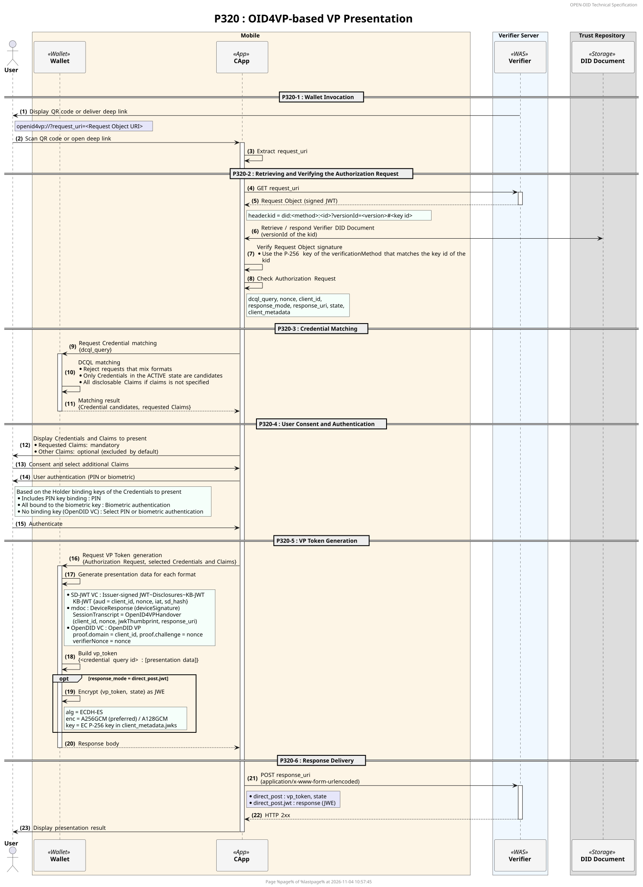
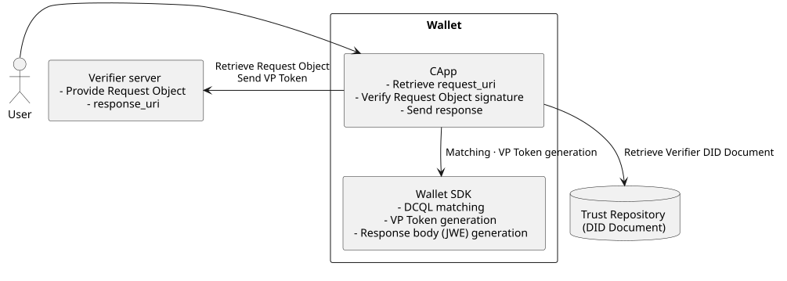
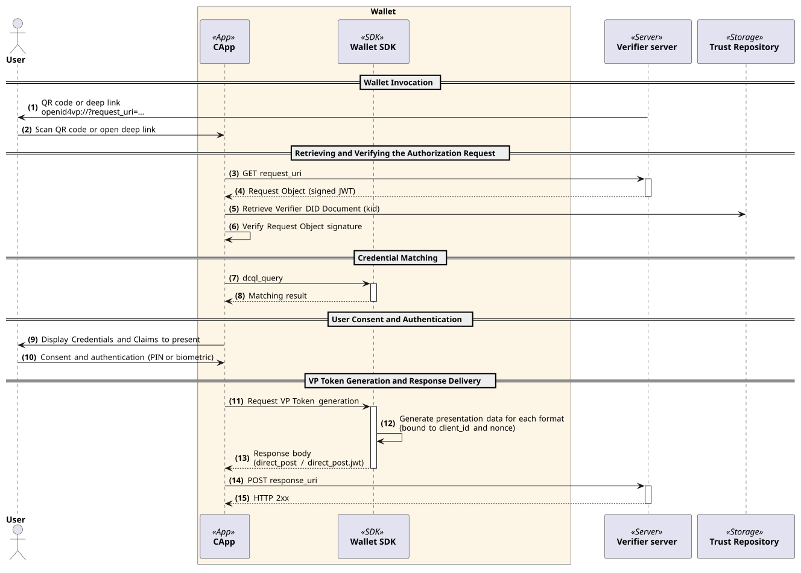

---
puppeteer:
    pdf:
        format: A4
        displayHeaderFooter: true
        landscape: false
        scale: 0.8
        margin:
            top: 1.2cm
            right: 1cm
            bottom: 1cm
            left: 1cm
    image:
        quality: 100
        fullPage: false
---

OID4VP-based VP Presentation
==

- Subject: Explanation of OID4VP-based VP Presentation Concept
- Author: OpenSource Development Team
- Date: 2026-11-12
- Version: v1.0.0

| Version | Date       | Changes         |
| ------- | ---------- | --------------- |
| v1.0.0  | 2026-11-12 | Initial version |

<br>

Table of Contents
---

<!-- TOC tocDepth:2..4 chapterDepth:2..6 -->

- [1. Overview](#1-overview)
    - [1.1. Reference Documents](#11-reference-documents)
        - [1.1.1. OID4VP-based VP Presentation Sequence (P320)](#111-oid4vp-based-vp-presentation-sequence-p320)
    - [1.2. Terminology](#12-terminology)
    - [1.3. Comparison with the OpenDID Presentation Protocol](#13-comparison-with-the-opendid-presentation-protocol)
- [2. Components](#2-components)
- [3. Preliminary Procedures](#3-preliminary-procedures)
    - [3.1. Verifier DID and Signing Key](#31-verifier-did-and-signing-key)
    - [3.2. Supported Credential Formats](#32-supported-credential-formats)
- [4. Presentation Procedures](#4-presentation-procedures)
    - [4.1. Wallet Invocation](#41-wallet-invocation)
    - [4.2. Retrieving and Verifying the Authorization Request](#42-retrieving-and-verifying-the-authorization-request)
    - [4.3. Credential Matching (DCQL)](#43-credential-matching-dcql)
    - [4.4. User Consent and Authentication](#44-user-consent-and-authentication)
    - [4.5. VP Token Generation](#45-vp-token-generation)
        - [4.5.1. SD-JWT VC](#451-sd-jwt-vc)
        - [4.5.2. mdoc](#452-mdoc)
        - [4.5.3. OpenDID VC](#453-opendid-vc)
    - [4.6. Response Delivery](#46-response-delivery)
- [5. Implementation Scope and Constraints](#5-implementation-scope-and-constraints)
- [6. Differences from the Standard](#6-differences-from-the-standard)

<!-- /TOC -->


<div style="page-break-after: always;"></div>

## 1. Overview

This document describes the overall concept of OID4VP (OpenID for Verifiable Presentations)-based VP presentation supported in OpenDID 3.0.
OpenDID supports OID4VP presentation together with the existing OpenDID presentation protocol (refer to [PRESENT-VP]),
and Credentials in the SD-JWT VC, ISO mdoc, and OpenDID VC formats are presented through OID4VP.

The OID4VP-based VP presentation proceeds in the following order.

1. Preliminary procedures
    - (A) Verifier DID and signing key - Register the key used to sign the Request Object in the DID Document
    - (B) Supported Credential formats - Format identifiers used in DCQL
1. Presentation procedures
    - (C) Wallet invocation - Deliver the `request_uri` through a QR code or deep link
    - (D) Retrieving and verifying the Authorization Request - Retrieve the Request Object and verify its signature
    - (E) Credential matching - Find Credentials that match the DCQL request
    - (F) User consent and authentication - Confirm the Claims to present, PIN or biometric authentication
    - (G) VP Token generation - Generate the presentation data for each format
    - (H) Response delivery - Send the VP Token to the `response_uri`

### 1.1. Reference Documents

| Reference Name     | Document Title                                           | Location |
| ------------------ | -------------------------------------------------------- | -------- |
| [OID4VP]           | OpenID for Verifiable Presentations 1.0                  | https://openid.net/specs/openid-4-verifiable-presentations-1_0.html |
| [SD-JWT-VC]        | SD-JWT-based Verifiable Digital Credentials (SD-JWT VC)  | https://datatracker.ietf.org/doc/draft-ietf-oauth-sd-jwt-vc/ |
| [ISO-18013-5]      | ISO/IEC 18013-5 Mobile driving licence (mDL) application | https://www.iso.org/standard/69084.html |
| [RFC7516]          | JSON Web Encryption (JWE)                                | https://www.rfc-editor.org/rfc/rfc7516 |
| [PRESENT-VP]       | (OpenDID) Presentation of VP                             | [Presentation of VP.md](Presentation%20of%20VP.md) |
| [SD-JWT-VC-FORMAT] | (OpenDID) SD-JWT VC format                               | [SD-JWT VC format.md](./../data%20standard/oid4vc%20credential%20format/SD-JWT%20VC%20format.md) |
| [MDOC-FORMAT]      | (OpenDID) mdoc format                                    | [mdoc format.md](./../data%20standard/oid4vc%20credential%20format/mdoc%20format.md) |
| [VP-FORMAT]        | (OpenDID) VP format                                      | [VP format.md](./../data%20standard/verifiable%20credential%20format/VP%20format.md) |
| [PRESENT-OID4VP-SEQ] | (OpenDID) OID4VP-based VP Presentation Sequence (P320) | [P320 Sequence](#111-oid4vp-based-vp-presentation-sequence-p320) |

#### 1.1.1. OID4VP-based VP Presentation Sequence (P320)



- Source: `docs/sequence/detailed/P320_oid4vp_submit.puml`

### 1.2. Terminology

| Term | Description |
| ---- | ----------- |
| Verifier | The entity that requests, receives, and verifies VPs. In OpenDID, the Verifier server performs this role. |
| Authorization Request | The information with which the verifier requests a presentation from the wallet. It contains the Credentials to present and the response method. |
| Request Object | A JWT signed by the verifier that contains the Authorization Request |
| `request_uri` | The URI from which the wallet retrieves the Request Object |
| DCQL | Digital Credentials Query Language. The query language that specifies the Credentials and Claims to present ([OID4VP]) |
| VP Token | The Credential presentation data that the wallet submits to the verifier |
| KB-JWT | Key Binding JWT. A JWT signed with the Holder key to prove key possession when presenting an SD-JWT VC ([SD-JWT-VC]) |
| DeviceResponse | mdoc presentation data ([ISO-18013-5]) |
| `response_uri` | The verifier URI to which the wallet sends the VP Token |

### 1.3. Comparison with the OpenDID Presentation Protocol

| Category | OpenDID Presentation Protocol (P310) | OID4VP-based Presentation |
| -------- | ------------------------------------ | ------------------------- |
| Initiation | VerifyOffer (QR, PUSH, App2App) | `openid4vp://` request (QR, deep link) |
| Request information | VerifyProfile | Request Object signed by the verifier |
| Specifying items to present | Filter of the VerifyProfile | DCQL (`dcql_query`) |
| Credential formats | OpenDID VC, ZKP Credential | SD-JWT VC, ISO mdoc, OpenDID VC |
| Presentation data | Encrypted VP | VP Token (`direct_post` / `direct_post.jwt`) |

The existing OpenDID presentation protocol remains supported after OID4VP presentation is added.


<div style="page-break-after: always;"></div>

## 2. Components

The components of OID4VP-based presentation are shown in the figure below.



| Component | Role |
| --------- | ---- |
| Wallet | Retrieves the Request Object and verifies its signature. Generates the VP Token with the user's consent and sends it to the verifier. |
| Verifier server | Signs and provides the Request Object, and receives the VP Token at the `response_uri`. |
| Trust Repository | Provides the verifier DID Document. The wallet verifies the Request Object signature with a key in this DID Document. |

Within the wallet, the roles are divided as follows.

| Category | Role |
| -------- | ---- |
| CApp | Retrieving the `request_uri`, verifying the Request Object signature, the user consent screen, and sending the response to the `response_uri` |
| Wallet SDK | DCQL matching, VP Token generation, and response body generation (including encryption) |


<div style="page-break-after: always;"></div>

## 3. Preliminary Procedures

### 3.1. Verifier DID and Signing Key

The verifier has a DID and signs the Request Object with a key registered in its DID Document.
The `kid` in the signature header of the Request Object is a DID URL that points to the signing key, in the following format.

```
did:<method>:<id>?versionId=<version>#<key id>
```

- `versionId` is required. The wallet looks up the key in the DID Document of the specified version.
- `#<key id>` must match the `id` of a `verificationMethod` in the DID Document.
- The signing key is a P-256 key.

### 3.2. Supported Credential Formats

The following format identifiers are used for `format` in DCQL.
They are OpenDID extension identifiers that are distinct from the standard identifiers (`dc+sd-jwt`, `mso_mdoc`).

| Format identifier | Credential | Presentation data |
| ----------------- | ---------- | ----------------- |
| `dc+sd-jwt-did` | SD-JWT VC ([SD-JWT-VC-FORMAT]) | SD-JWT + KB-JWT |
| `mso_mdoc-did` | ISO mdoc ([MDOC-FORMAT]) | DeviceResponse |
| `opendid_vc` | OpenDID VC | OpenDID VP ([VP-FORMAT]) |


<div style="page-break-after: always;"></div>

## 4. Presentation Procedures

The overall flow of OID4VP-based presentation is shown in the figure below. For the detailed procedure, refer to [PRESENT-OID4VP-SEQ].



### 4.1. Wallet Invocation

The verifier delivers a request containing the `request_uri` to the wallet through a QR code or deep link.

```
openid4vp://?request_uri=<Request Object URI>
```

The wallet handles QR codes and deep links in the same way and reads the `request_uri` from the request.

### 4.2. Retrieving and Verifying the Authorization Request

1. The wallet sends a GET request to the `request_uri` and receives the signed Request Object (JWT).
2. Using the `kid` in the signature header, the wallet retrieves the verifier DID Document (of the specified version) and finds the key that matches the key id of the `kid`.
3. The wallet verifies the Request Object signature with that key.
4. After the signature is verified, the wallet processes the Authorization Request.

The wallet uses the following Authorization Request parameters.

| Parameter | Purpose |
| --------- | ------- |
| `dcql_query` | Credentials and Claims to present (refer to 4.3) |
| `nonce` | Value that binds the VP Token to the request (refer to 4.5) |
| `client_id` | Verifier identifier. Used for VP Token binding (refer to 4.5). |
| `response_mode` | Response method (refer to 4.6) |
| `response_uri` | URI to which the VP Token is sent |
| `state` | Value returned unchanged in the response |
| `client_metadata` | Response encryption keys and supported encryption algorithms (when `direct_post.jwt` is used) |

### 4.3. Credential Matching (DCQL)

The wallet finds the Credentials that match the `dcql_query`.

- `format` uses the format identifiers in 3.2.
- A request that mixes different formats is rejected.
- If `claims` is not specified, all Claims that can be disclosed from the Credential are treated as requested.
- For `opendid_vc`, the Credential Schema is specified with `meta.credential_schema_id_values`.
- Only Credentials in the ACTIVE state are presentation candidates.
- If no Credential matches the request, or `credential_sets` cannot be satisfied, the presentation cannot proceed.

### 4.4. User Consent and Authentication

The wallet shows the Credentials and Claims to present to the user and obtains consent.

- Requested Claims are mandatory and cannot be excluded.
- Claims that are not requested can be added by the user. They are excluded by default.

The user authentication method before presentation is determined by the Holder binding keys of the Credentials to present.

| Binding key | Authentication method |
| ----------- | --------------------- |
| At least one Credential is bound to the PIN key | PIN |
| All Credentials are bound to the biometric key | Biometric authentication |
| No binding key (OpenDID VC) | If biometric authentication is available, the user selects PIN or biometric authentication; otherwise, PIN |

### 4.5. VP Token Generation

The VP Token is a JSON object that contains an array of presentation data for each `id` of the DCQL Credential query.

```json
{
    "<credential query id>": ["<presentation data>"]
}
```

#### 4.5.1. SD-JWT VC

The Issuer-signed JWT, the Disclosures selected by the user, and the KB-JWT are concatenated and presented.
The KB-JWT is signed with the Holder key and contains the following values.

| Item | Value |
| ---- | ----- |
| `typ` (header) | `kb+jwt` |
| `aud` | `client_id` of the Authorization Request |
| `nonce` | `nonce` of the Authorization Request |
| `iat` | Creation time |
| `sd_hash` | SHA-256 hash (base64url) of the concatenation of the Issuer-signed JWT and the selected Disclosures |

#### 4.5.2. mdoc

A DeviceResponse is generated and presented. DeviceAuth uses `deviceSignature` (signature).
The SessionTranscript is constructed as follows.

```
SessionTranscript = [null, null, OpenID4VPHandover]
OpenID4VPHandover = ["OpenID4VPHandover", SHA-256(CBOR([client_id, nonce, jwkThumbprint, response_uri]))]
```

- `client_id`, `nonce`, `response_uri`: Values of the Authorization Request
- `jwkThumbprint`: The SHA-256 thumbprint of the response encryption JWK for `direct_post.jwt`, or `null` for `direct_post`

#### 4.5.3. OpenDID VC

An OpenDID VP ([VP-FORMAT]) is presented as a JSON object.
The OID4VP request values are reflected in the VP as follows.

| VP item | Value |
| ------- | ----- |
| `proof.domain` | `client_id` of the Authorization Request |
| `proof.challenge` | `nonce` of the Authorization Request |
| `verifierNonce` | `nonce` of the Authorization Request |

If the user selects only some Claims, only the `proofValueList` of the selected Claims is included in the VP.

### 4.6. Response Delivery

The wallet sends a POST request in `application/x-www-form-urlencoded` format to the `response_uri`.
The presentation is treated as complete when an HTTP 2xx response is received.

| `response_mode` | Request body |
| --------------- | ------------ |
| `direct_post` | `vp_token` (VP Token JSON), `state` |
| `direct_post.jwt` | `response` (JWE that encrypts `{vp_token, state}`) |

The JWE ([RFC7516]) for `direct_post.jwt` is generated as follows.

| Item | Value |
| ---- | ----- |
| Encryption key | An EC P-256 key in `client_metadata.jwks`. A key whose `use` is `enc` is used first. |
| `alg` | `ECDH-ES` |
| `enc` | `A256GCM` is selected first from `client_metadata.encrypted_response_enc_values_supported`, then `A128GCM`. If the list is absent, `A256GCM` is used. |
| `kid` (header) | `kid` of the encryption key |


<div style="page-break-after: always;"></div>

## 5. Implementation Scope and Constraints

The OID4VP implementation of OpenDID 3.0 is limited to the following scope.

| Item | Current Behavior |
| ---- | ---------------- |
| Request Object delivery | Only `request_uri` (GET) is supported. Passing the value directly with `request` and `request_uri_method=post` are not supported. |
| Response method | Only `direct_post` and `direct_post.jwt` are supported. |
| Redirect after response | The `redirect_uri` in the response is not processed. |
| DCQL | Credentials of different formats cannot be mixed in a single request. |
| Transaction Data | `transaction_data` is not supported. |
| Digital Credentials API | Not supported. |

<div style="page-break-after: always;"></div>

## 6. Differences from the Standard

The OID4VP of OpenDID 3.0 differs from [OID4VP] in the following parts.

| Item | [OID4VP] | OpenDID |
| ---- | -------- | ------- |
| Credential format identifiers | `dc+sd-jwt`, `mso_mdoc` | Uses `dc+sd-jwt-did` and `mso_mdoc-did` (refer to [3.2](#32-supported-credential-formats)). It does not interoperate with verifiers that request with the standard identifiers. |
| W3C VC formats | `jwt_vc_json`, `ldp_vc` | Not supported. OpenDID VCs are presented with `opendid_vc` (refer to [4.5.3](#453-opendid-vc)). |
| DCQL without `claims` | Selectively disclosable claims are regarded as not requested. | All claims that can be disclosed are regarded as requested (refer to [4.3](#43-credential-matching-dcql)). |
| DCQL mixing different formats | Allowed. | The request is rejected. |
| Default `enc` of `direct_post.jwt` | `A128GCM` | `A256GCM` (refer to [4.6](#46-response-delivery)) |
| SessionTranscript for remote mdoc presentation | ISO/IEC 18013-7 defines a separate OID4VP profile. | Uses the OpenID4VPHandover of [OID4VP] (refer to [4.5.2](#452-mdoc)). DeviceAuth verification does not match with verifiers that use the ISO/IEC 18013-7 profile. |
