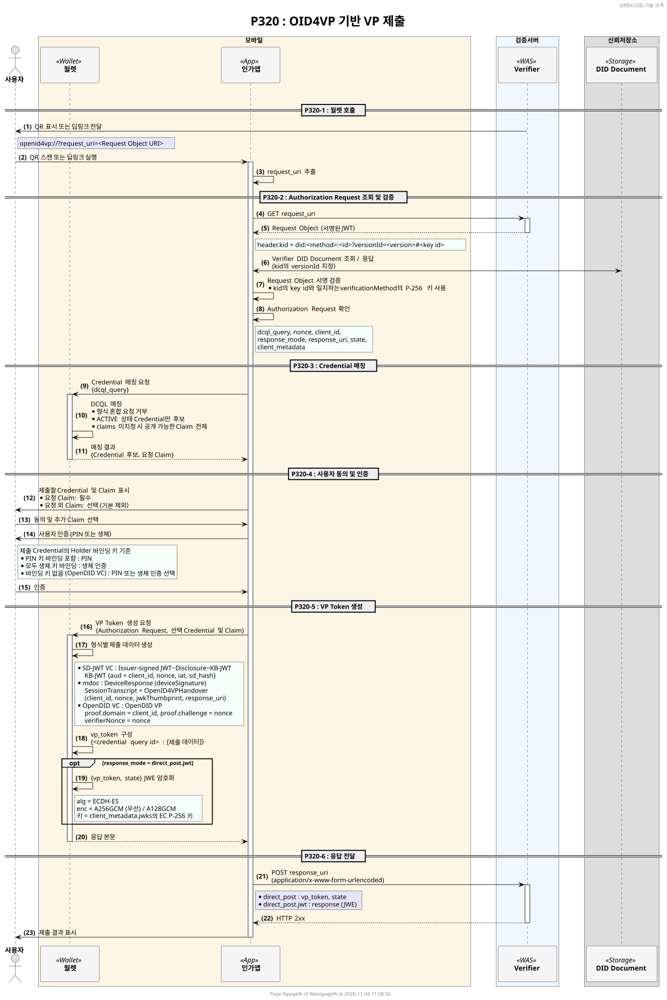
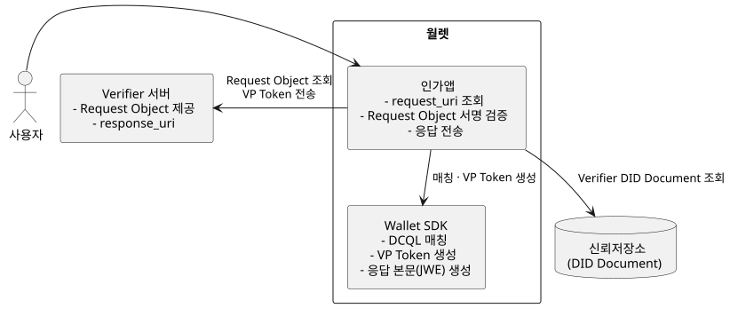
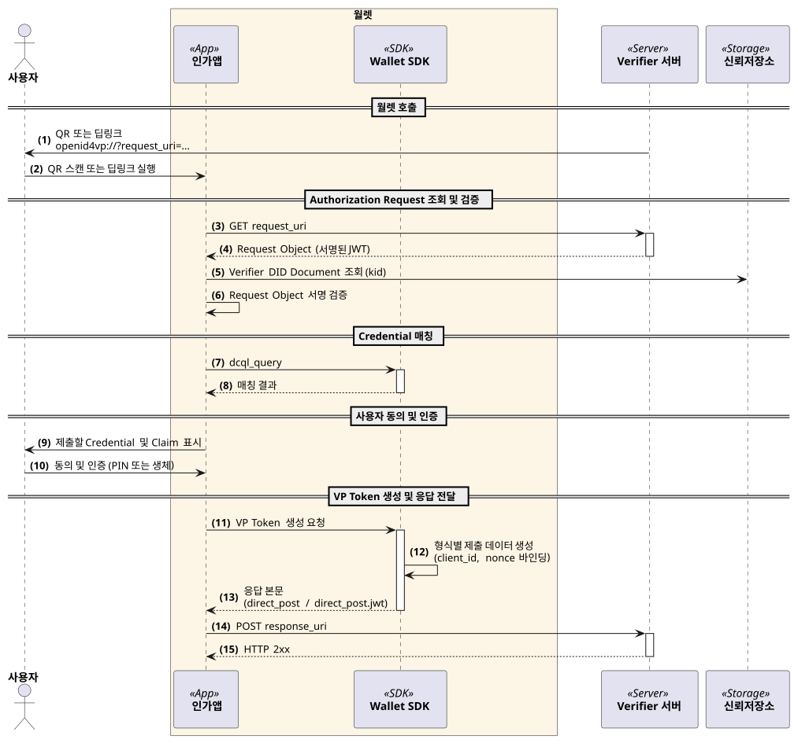

---
puppeteer:
    pdf:
        format: A4
        displayHeaderFooter: true
        landscape: false
        scale: 0.8
        margin:
            top: 1.2cm
            right: 1cm
            bottom: 1cm
            left: 1cm
    image:
        quality: 100
        fullPage: false
---

OID4VP 기반 VP 제출
==

- 주제: OID4VP 기반 VP 제출 개념 설명
- 작성: 오픈소스개발팀
- 일자: 2026-11-12
- 버전: v1.0.0

| 버전   | 일자       | 변경 내용 |
| ------ | ---------- | --------- |
| v1.0.0 | 2026-11-12 | 초안      |

<br>

목차
---

<!-- TOC tocDepth:2..4 chapterDepth:2..6 -->

- [1. 개요](#1-개요)
    - [1.1. 참조문서](#11-참조문서)
        - [1.1.1. OID4VP 기반 VP 제출 절차도 (P320)](#111-oid4vp-기반-vp-제출-절차도-p320)
    - [1.2. 용어](#12-용어)
    - [1.3. OpenDID 제출 프로토콜과의 비교](#13-opendid-제출-프로토콜과의-비교)
- [2. 구성 요소](#2-구성-요소)
- [3. 사전준비 절차](#3-사전준비-절차)
    - [3.1. 검증자 DID 및 서명 키](#31-검증자-did-및-서명-키)
    - [3.2. 지원 Credential 형식](#32-지원-credential-형식)
- [4. 제출 절차](#4-제출-절차)
    - [4.1. 월렛 호출](#41-월렛-호출)
    - [4.2. Authorization Request 조회 및 검증](#42-authorization-request-조회-및-검증)
    - [4.3. Credential 매칭 (DCQL)](#43-credential-매칭-dcql)
    - [4.4. 사용자 동의 및 인증](#44-사용자-동의-및-인증)
    - [4.5. VP Token 생성](#45-vp-token-생성)
        - [4.5.1. SD-JWT VC](#451-sd-jwt-vc)
        - [4.5.2. mdoc](#452-mdoc)
        - [4.5.3. OpenDID VC](#453-opendid-vc)
    - [4.6. 응답 전달](#46-응답-전달)
- [5. 구현 범위 및 제약](#5-구현-범위-및-제약)
- [6. 표준과의 차이](#6-표준과의-차이)

<!-- /TOC -->


<div style="page-break-after: always;"></div>

## 1. 개요

본 문서는 OpenDID 3.0에서 지원하는 OID4VP(OpenID for Verifiable Presentations) 기반 VP 제출의 전반적인 개념을 설명한다.
OpenDID는 기존 OpenDID 제출 프로토콜([PRESENT-VP] 참조)과 함께 OID4VP 제출을 지원하며,
OID4VP로는 SD-JWT VC, ISO mdoc, OpenDID VC 형식의 Credential을 제출한다.

OID4VP 기반 VP 제출 순서는 다음과 같다.

1. 사전준비 절차
    - (A) 검증자 DID 및 서명 키 - Request Object 서명에 사용할 키를 DID Document에 등록
    - (B) 지원 Credential 형식 - DCQL에서 사용하는 형식 식별자
1. 제출 절차
    - (C) 월렛 호출 - QR 또는 딥링크로 `request_uri` 전달
    - (D) Authorization Request 조회 및 검증 - Request Object 조회, 서명 검증
    - (E) Credential 매칭 - DCQL 요청에 맞는 Credential 탐색
    - (F) 사용자 동의 및 인증 - 제출할 Claim 확인, PIN 또는 생체 인증
    - (G) VP Token 생성 - 형식별 제출 데이터 생성
    - (H) 응답 전달 - `response_uri`로 VP Token 전송

### 1.1. 참조문서

| 참조명             | 문서명                                                   | 위치 |
| ------------------ | -------------------------------------------------------- | ---- |
| [OID4VP]           | OpenID for Verifiable Presentations 1.0                  | https://openid.net/specs/openid-4-verifiable-presentations-1_0.html |
| [SD-JWT-VC]        | SD-JWT-based Verifiable Digital Credentials (SD-JWT VC)  | https://datatracker.ietf.org/doc/draft-ietf-oauth-sd-jwt-vc/ |
| [ISO-18013-5]      | ISO/IEC 18013-5 Mobile driving licence (mDL) application | https://www.iso.org/standard/69084.html |
| [RFC7516]          | JSON Web Encryption (JWE)                                | https://www.rfc-editor.org/rfc/rfc7516 |
| [PRESENT-VP]       | (OpenDID) VP 제출                                        | [Presentation of VP_ko.md](Presentation%20of%20VP_ko.md) |
| [SD-JWT-VC-FORMAT] | (OpenDID) SD-JWT VC format                               | [SD-JWT VC format_ko.md](./../data%20standard/oid4vc%20credential%20format/SD-JWT%20VC%20format_ko.md) |
| [MDOC-FORMAT]      | (OpenDID) mdoc format                                    | [mdoc format_ko.md](./../data%20standard/oid4vc%20credential%20format/mdoc%20format_ko.md) |
| [VP-FORMAT]        | (OpenDID) VP format                                      | [VP format_ko.md](./../data%20standard/verifiable%20credential%20format/VP%20format_ko.md) |
| [PRESENT-OID4VP-SEQ] | (OpenDID) OID4VP 기반 VP 제출 절차도 (P320)            | [P320 절차도](#111-oid4vp-기반-vp-제출-절차도-p320) |

#### 1.1.1. OID4VP 기반 VP 제출 절차도 (P320)



- 원본: `docs/sequence/detailed/P320_oid4vp_submit_ko.puml`

### 1.2. 용어

| 용어 | 설명 |
| ---- | ---- |
| Verifier | VP를 요청하고 제출받아 검증하는 주체. OpenDID에서는 Verifier 서버가 수행한다. |
| Authorization Request | 검증자가 월렛에 제출을 요청하는 정보. 제출할 Credential과 응답 방식을 담는다. |
| Request Object | Authorization Request를 담아 검증자가 서명한 JWT |
| `request_uri` | 월렛이 Request Object를 조회하는 URI |
| DCQL | Digital Credentials Query Language. 제출할 Credential과 Claim을 지정하는 요청 언어 ([OID4VP]) |
| VP Token | 월렛이 검증자에게 제출하는 Credential 제출 데이터 |
| KB-JWT | Key Binding JWT. SD-JWT VC 제출 시 Holder 키로 서명하여 키 소유를 증명하는 JWT ([SD-JWT-VC]) |
| DeviceResponse | mdoc 제출 데이터 ([ISO-18013-5]) |
| `response_uri` | 월렛이 VP Token을 전송하는 검증자의 URI |

### 1.3. OpenDID 제출 프로토콜과의 비교

| 구분 | OpenDID 제출 프로토콜 (P310) | OID4VP 기반 제출 |
| ---- | --------------------------- | ---------------- |
| 제출 개시 | VerifyOffer (QR, PUSH, App2App) | `openid4vp://` 요청 (QR, 딥링크) |
| 요청 정보 | VerifyProfile | 검증자가 서명한 Request Object |
| 제출 항목 지정 | VerifyProfile의 filter | DCQL (`dcql_query`) |
| Credential 형식 | OpenDID VC, ZKP Credential | SD-JWT VC, ISO mdoc, OpenDID VC |
| 제출 데이터 | 암호화된 VP | VP Token (`direct_post` / `direct_post.jwt`) |

OID4VP 제출이 추가되어도 기존 OpenDID 제출 프로토콜은 그대로 지원한다.


<div style="page-break-after: always;"></div>

## 2. 구성 요소

OID4VP 기반 제출의 구성 요소는 아래 그림과 같다.



| 구성 요소 | 역할 |
| --------- | ---- |
| 월렛 | Request Object를 조회하고 서명을 검증한다. 사용자 동의를 받아 VP Token을 생성하고 검증자에게 전송한다. |
| Verifier 서버 | Request Object를 서명하여 제공하고, `response_uri`로 VP Token을 받는다. |
| 신뢰저장소 | 검증자 DID Document를 제공한다. 월렛은 이 DID Document의 키로 Request Object 서명을 검증한다. |

월렛 내부에서는 다음과 같이 역할을 나눈다.

| 구분 | 역할 |
| ---- | ---- |
| 인가앱 | `request_uri` 조회, Request Object 서명 검증, 사용자 동의 화면, `response_uri`로 응답 전송 |
| Wallet SDK | DCQL 매칭, VP Token 생성, 응답 본문(암호화 포함) 생성 |


<div style="page-break-after: always;"></div>

## 3. 사전준비 절차

### 3.1. 검증자 DID 및 서명 키

검증자는 DID를 가지며, Request Object를 DID Document에 등록한 키로 서명한다.
Request Object의 서명 헤더 `kid`는 서명 키를 가리키는 DID URL이며, 다음 형식을 따른다.

```
did:<method>:<id>?versionId=<version>#<key id>
```

- `versionId`는 필수이다. 월렛은 지정된 버전의 DID Document에서 키를 찾는다.
- `#<key id>`는 DID Document `verificationMethod`의 `id`와 일치해야 한다.
- 서명 키는 P-256 키이다.

### 3.2. 지원 Credential 형식

DCQL의 `format`에는 다음 형식 식별자를 사용한다.
표준 식별자(`dc+sd-jwt`, `mso_mdoc`)와 구분되는 OpenDID 확장 식별자이다.

| 형식 식별자 | Credential | 제출 데이터 |
| ----------- | ---------- | ----------- |
| `dc+sd-jwt-did` | SD-JWT VC ([SD-JWT-VC-FORMAT]) | SD-JWT + KB-JWT |
| `mso_mdoc-did` | ISO mdoc ([MDOC-FORMAT]) | DeviceResponse |
| `opendid_vc` | OpenDID VC | OpenDID VP ([VP-FORMAT]) |


<div style="page-break-after: always;"></div>

## 4. 제출 절차

OID4VP 기반 제출의 전체 흐름은 아래 그림과 같다. 상세 절차는 [PRESENT-OID4VP-SEQ]를 참조한다.



### 4.1. 월렛 호출

검증자는 `request_uri`를 담은 요청을 QR 또는 딥링크로 월렛에 전달한다.

```
openid4vp://?request_uri=<Request Object URI>
```

월렛은 QR과 딥링크를 같은 방식으로 처리하며, 요청에서 `request_uri`를 읽는다.

### 4.2. Authorization Request 조회 및 검증

1. 월렛은 `request_uri`로 GET 요청을 보내 서명된 Request Object(JWT)를 받는다.
2. 서명 헤더의 `kid`로 검증자 DID Document(지정 버전)를 조회하고, `kid`의 key id와 일치하는 키를 찾는다.
3. 찾은 키로 Request Object 서명을 검증한다.
4. 서명이 검증되면 Authorization Request를 처리한다.

월렛이 사용하는 Authorization Request 항목은 다음과 같다.

| 항목 | 용도 |
| ---- | ---- |
| `dcql_query` | 제출할 Credential과 Claim (4.3 참조) |
| `nonce` | VP Token을 요청에 바인딩하는 값 (4.5 참조) |
| `client_id` | 검증자 식별자. VP Token 바인딩에 사용한다 (4.5 참조). |
| `response_mode` | 응답 방식 (4.6 참조) |
| `response_uri` | VP Token을 전송할 URI |
| `state` | 응답에 그대로 포함하여 돌려주는 값 |
| `client_metadata` | 응답 암호화 키와 지원 암호화 알고리즘 (`direct_post.jwt` 사용 시) |

### 4.3. Credential 매칭 (DCQL)

월렛은 `dcql_query`에 맞는 Credential을 찾는다.

- `format`은 3.2의 형식 식별자를 사용한다.
- 하나의 요청에 서로 다른 형식이 섞여 있으면 요청을 거부한다.
- `claims`를 지정하지 않으면 해당 Credential에서 공개할 수 있는 Claim 전체를 요청한 것으로 본다.
- `opendid_vc`는 `meta.credential_schema_id_values`로 Credential Schema를 지정한다.
- 상태가 ACTIVE인 Credential만 제출 후보가 된다.
- 요청에 맞는 Credential이 없거나 `credential_sets`를 충족하지 못하면 제출할 수 없다.

### 4.4. 사용자 동의 및 인증

월렛은 제출할 Credential과 Claim을 사용자에게 보여주고 동의를 받는다.

- 요청된 Claim은 필수 항목이며 제외할 수 없다.
- 요청되지 않은 Claim은 사용자가 선택하여 추가할 수 있다. 기본값은 제외이다.

제출 전 사용자 인증 수단은 제출할 Credential의 Holder 바인딩 키에 따라 정한다.

| 바인딩 키 | 인증 수단 |
| --------- | --------- |
| PIN 키에 바인딩된 Credential이 하나라도 있는 경우 | PIN |
| 모든 Credential이 생체 키에 바인딩된 경우 | 생체 인증 |
| 바인딩 키가 없는 경우 (OpenDID VC) | 생체 인증을 사용할 수 있으면 사용자가 PIN 또는 생체 인증을 선택하고, 그렇지 않으면 PIN |

### 4.5. VP Token 생성

VP Token은 DCQL Credential query의 `id`별로 제출 데이터 배열을 담은 JSON 객체이다.

```json
{
    "<credential query id>": ["<제출 데이터>"]
}
```

#### 4.5.1. SD-JWT VC

Issuer-signed JWT, 사용자가 선택한 Disclosure, KB-JWT를 연결하여 제출한다.
KB-JWT는 Holder 키로 서명하며 다음 값을 담는다.

| 항목 | 값 |
| ---- | -- |
| `typ` (헤더) | `kb+jwt` |
| `aud` | Authorization Request의 `client_id` |
| `nonce` | Authorization Request의 `nonce` |
| `iat` | 생성 시각 |
| `sd_hash` | Issuer-signed JWT와 선택한 Disclosure를 연결한 값의 SHA-256 해시 (base64url) |

#### 4.5.2. mdoc

DeviceResponse를 생성하여 제출한다. DeviceAuth는 `deviceSignature`(서명)를 사용한다.
SessionTranscript는 다음과 같이 구성한다.

```
SessionTranscript = [null, null, OpenID4VPHandover]
OpenID4VPHandover = ["OpenID4VPHandover", SHA-256(CBOR([client_id, nonce, jwkThumbprint, response_uri]))]
```

- `client_id`, `nonce`, `response_uri`: Authorization Request의 값
- `jwkThumbprint`: `direct_post.jwt`이면 응답 암호화 JWK의 SHA-256 thumbprint, `direct_post`이면 `null`

#### 4.5.3. OpenDID VC

OpenDID VP([VP-FORMAT])를 JSON 객체로 제출한다.
OID4VP 요청 값은 VP에 다음과 같이 반영한다.

| VP 항목 | 값 |
| ------- | -- |
| `proof.domain` | Authorization Request의 `client_id` |
| `proof.challenge` | Authorization Request의 `nonce` |
| `verifierNonce` | Authorization Request의 `nonce` |

사용자가 일부 Claim만 선택한 경우, 선택한 Claim의 `proofValueList`만 VP에 포함한다.

### 4.6. 응답 전달

월렛은 `response_uri`로 `application/x-www-form-urlencoded` 형식의 POST 요청을 보낸다.
HTTP 2xx 응답을 받으면 제출이 완료된 것으로 처리한다.

| `response_mode` | 요청 본문 |
| --------------- | --------- |
| `direct_post` | `vp_token`(VP Token JSON), `state` |
| `direct_post.jwt` | `response`(`{vp_token, state}`를 암호화한 JWE) |

`direct_post.jwt`의 JWE([RFC7516])는 다음과 같이 생성한다.

| 항목 | 값 |
| ---- | -- |
| 암호화 키 | `client_metadata.jwks`의 EC P-256 키. `use`가 `enc`인 키를 우선 사용한다. |
| `alg` | `ECDH-ES` |
| `enc` | `client_metadata.encrypted_response_enc_values_supported`에서 `A256GCM`을 우선 선택하고, 없으면 `A128GCM`을 선택한다. 목록이 없으면 `A256GCM`을 사용한다. |
| `kid` (헤더) | 암호화 키의 `kid` |


<div style="page-break-after: always;"></div>

## 5. 구현 범위 및 제약

OpenDID 3.0의 OID4VP 구현은 다음 범위로 제한된다.

| 항목 | 현재 동작 |
| ---- | --------- |
| Request Object 전달 | `request_uri`(GET)만 지원한다. `request`로 값을 직접 전달하는 방식과 `request_uri_method=post`는 지원하지 않는다. |
| 응답 방식 | `direct_post`, `direct_post.jwt`만 지원한다. |
| 응답 후 이동 | 응답의 `redirect_uri`는 처리하지 않는다. |
| DCQL | 하나의 요청에 서로 다른 형식의 Credential을 섞을 수 없다. |
| Transaction Data | `transaction_data`는 지원하지 않는다. |
| Digital Credentials API | 지원하지 않는다. |

<div style="page-break-after: always;"></div>

## 6. 표준과의 차이

OpenDID 3.0의 OID4VP는 [OID4VP]와 다음 부분이 다르다.

| 항목 | [OID4VP] | OpenDID |
| ---- | -------- | ------- |
| Credential 형식 식별자 | `dc+sd-jwt`, `mso_mdoc` | `dc+sd-jwt-did`, `mso_mdoc-did`를 사용한다([3.2](#32-지원-credential-형식) 참조). 표준 식별자로 요청하는 검증자와는 연동되지 않는다. |
| W3C VC 형식 | `jwt_vc_json`, `ldp_vc` | 지원하지 않는다. OpenDID VC는 `opendid_vc`로 제출한다([4.5.3](#453-opendid-vc) 참조). |
| `claims`를 생략한 DCQL | 선택적으로 공개하는 Claim은 요청하지 않은 것으로 본다. | 공개할 수 있는 Claim 전체를 요청한 것으로 본다([4.3](#43-credential-매칭-dcql) 참조). |
| 서로 다른 형식이 섞인 DCQL | 허용한다. | 요청을 거부한다. |
| `direct_post.jwt`의 기본 `enc` | `A128GCM` | `A256GCM`([4.6](#46-응답-전달) 참조) |
| mdoc 원격 제출의 SessionTranscript | ISO/IEC 18013-7의 OID4VP 프로파일을 별도로 정의한다. | [OID4VP]의 OpenID4VPHandover를 사용한다([4.5.2](#452-mdoc) 참조). ISO/IEC 18013-7 프로파일을 사용하는 검증자와는 DeviceAuth 검증이 맞지 않는다. |
