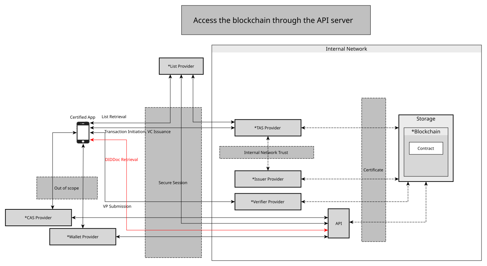
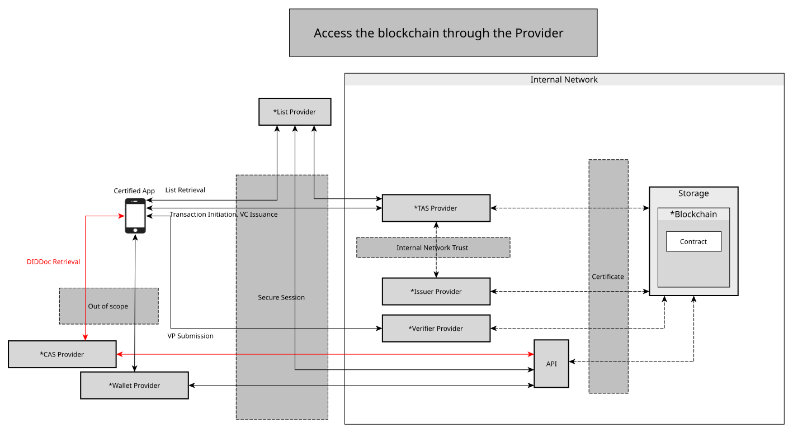

# Blockchain Integration

- Subject: Blockchain Integration
- Author: OpenSource Development Team
- Date: 2026-10-23
- Version: v1.1.0

| Version | Date       | Changes         |
| ------- | ---------- | --------------- |
| v1.1.0  | 2026-10-23 | Add storage integration via LSS |
| v1.0.0  | 2024-10-18 | Initial version |

 

## Connecting to the Blockchain via API Server
- For public blockchains, direct access from external networks to the blockchain is possible.
- In OpenDID, rather than connecting directly from the app to the blockchain, a server-mediated approach is utilized.
- An API server, certified with an authentication certificate, sits in front of the blockchain, enabling access to it.

## Blockchain Integration via Providers
- Assume a trust channel exists between wallet-to-wallet servers and CApp-to-CApp servers.
    - Communication among services provided by different providers is considered out of scope.
- Private blockchains do not allow direct external access.
- A server receiving requests in front of the blockchain is necessary.
    - Each provider assumes this role.
    - Wallets and CApps access the blockchain via their respective servers.
- Security Sessions
    - Security session establishment can be omitted among providers within the intranet.
    - External networks require a security session to access the intranet.

## Storage Integration via LSS
- In environments without blockchain infrastructure, the LSS (Ledger Service Server) can be used as the trust repository instead of the blockchain.
    - The LSS provides the same functions as the blockchain using a PostgreSQL database.
    - It registers and retrieves DID Documents, VC Meta, VC Schemas, and ZKP Credential Schemas/Definitions.
- When the `lss` profile is active, a server accesses the repository through the LSS API (`{lss.url}/lss/api/v1`) instead of the blockchain.
    - Example: `--spring.profiles.active=dev,lss`
    - `lss.url` is set in `application-lss.yml`, and the default value is `http://127.0.0.1:8098`.
- For details, refer to [Ledger Service Server](https://github.com/OmniOneID/did-ledger-service-server).

### API Key Authentication
- The LSS authenticates the caller with the `X-API-Key` header of each request.
- API Keys are issued and managed on the API Key management screen of the LSS Admin Console (management API: `/lss/admin/v1/api-keys`).
    - A name, a role, and a validity period (in days) are specified when a key is issued.
    - The plain key is shown only once at issuance, and the LSS stores only the SHA-256 hash of each key.
    - An issued key can be deactivated and activated again. Renewing a key extends its validity period without changing the key value.
    - A key whose validity period has passed is rejected.
- Each API Key has a role, and the callable APIs differ by role.

| Role     | Callable APIs |
| -------- | ------------- |
| `TAS`    | All APIs under `/lss/api/v1` (including DID Document registration and update) |
| `ISSUER` | VC Meta registration and update, VC Schema registration, ZKP Credential Schema/Definition registration, all retrieval APIs |
| `READ`   | Retrieval APIs |

- Whether keys are validated is set on the Server Configuration screen of the LSS Admin Console (`API Key Validation`, configuration key `API_KEY_VALIDATION_ENABLED`), and the default is not validated (`false`).
- The TAS and Issuer servers put the `API_KEY_LSS` value of the `server_config` table in the `X-API-Key` header of every LSS request.
    - This value is changed in the Server Configuration menu of the TAS and Issuer Admin Consoles.
    - If the value is missing or empty, the LSS request fails.
