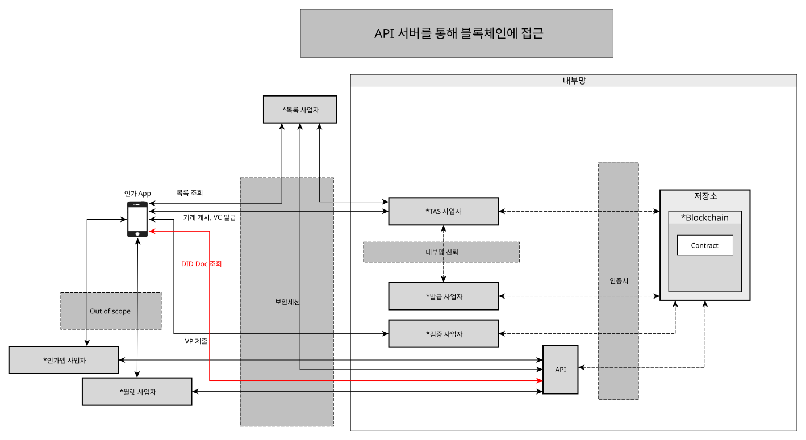
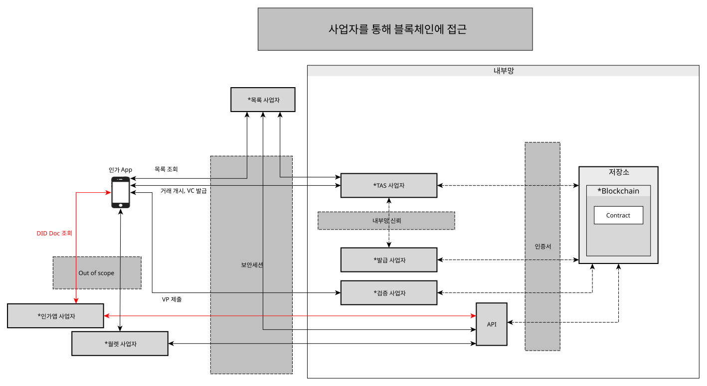

# 블록체인 연동

- 주제 : 블록체인 연동
- 작성 : 오픈소스개발팀
- 일자 : 2026-10-23
- 버전 : v1.1.0

| 버전 | 일자       | 변경         |
| ------- | ---------- | --------------- |
| v1.1.0  | 2026-10-23 | LSS를 통한 저장소 연동 추가 |
| v1.0.0  | 2024-10-18 | 최초 작성 |

 

## API 서버를 통한 블록체인 연동
- Public 블록체인의 경우 외부망에서 블록체인에 직접 접근할 수 있다.
- OpenDID에선 APP에서 직접 블록체인에 붙는것이 아닌 서버를 통해서 붙는 방식을 사용한다.
- 블록체인 앞단에는 인증서를 발급받은 API 서버가 존재하며 이를 통해 블록체인에 접근할 수 있다.

## 사업자를 통한 블록체인 연동
- 월렛-월렛 서버, 인가앱-인가앱 서버 간에는 신뢰채널이 형성되어 있다고 가정한다.
    - 사업자가 제공하는 서비스들간의 통신은 out of scope로 한다.
- Private 블록체인의 경우 외부에서 직접 접근할 수 없다. 
- 블록체인 앞에서 요청을 받아주는 서버가 필요하다. 이 역할을 각 사업자가 맡아서 진행한다.
    - 월렛은 월렛서버, 인가앱은 인가앱 서버를 통해서 블록체인에 접근한다.
- 보안세션
    - 내부망에 있는 사업자들간에는 보안세션 연결 과정을 생략할 수 있다.
    - 외부망에서 내부망에 접근하기 위해선 보안세션 과정을 진행해야 한다.
    

## LSS를 통한 저장소 연동
- 블록체인 인프라를 구축하지 않는 환경에서는 LSS(Ledger Service Server)를 블록체인 대신 신뢰 저장소로 사용할 수 있다.
    - LSS는 PostgreSQL 데이터베이스로 블록체인과 동일한 기능을 제공한다.
    - DID Document, VC Meta, VC Schema, ZKP Credential Schema/Definition을 등록하고 조회한다.
- 서버는 `lss` 프로파일을 활성화하면 블록체인 대신 LSS API(`{lss.url}/lss/api/v1`)로 저장소에 접근한다.
    - 예: `--spring.profiles.active=dev,lss`
    - `lss.url`은 `application-lss.yml`에 설정하며, 기본값은 `http://127.0.0.1:8098`이다.
- 자세한 내용은 [Ledger Service Server](https://github.com/OmniOneID/did-ledger-service-server)를 참조한다.

### API Key 인증
- LSS는 요청의 `X-API-Key` 헤더로 호출자를 인증한다.
- API Key는 LSS Admin Console의 API Key 관리 화면에서 발급하고 관리한다. (관리 API: `/lss/admin/v1/api-keys`)
    - 발급 시 이름, 역할, 유효기간(일)을 지정한다.
    - Key 원문은 발급 시 한 번만 표시되며, LSS는 Key의 SHA-256 해시만 저장한다.
    - 발급한 Key는 비활성화하거나 다시 활성화할 수 있다. 갱신하면 Key 값은 그대로 두고 유효기간을 연장한다.
    - 유효기간이 지난 Key는 거부된다.
- API Key에는 역할이 지정되며, 역할별로 호출할 수 있는 API가 다르다.

| 역할     | 호출 가능한 API |
| -------- | --------------- |
| `TAS`    | `/lss/api/v1`의 모든 API (DID Document 등록·수정 포함) |
| `ISSUER` | VC Meta 등록·수정, VC Schema 등록, ZKP Credential Schema/Definition 등록, 모든 조회 API |
| `READ`   | 조회 API |

- Key 검증 여부는 LSS Admin Console의 Server Configuration 화면(`API Key Validation`, 설정 키 `API_KEY_VALIDATION_ENABLED`)에서 정하며, 기본값은 검증하지 않음(`false`)이다.
- TAS와 Issuer 서버는 `server_config` 테이블의 `API_KEY_LSS` 값을 모든 LSS 요청의 `X-API-Key` 헤더에 넣는다.
    - 이 값은 TAS와 Issuer Admin Console의 Server Configuration 메뉴에서 변경한다.
    - 값이 없거나 비어 있으면 LSS 요청이 실패한다.
