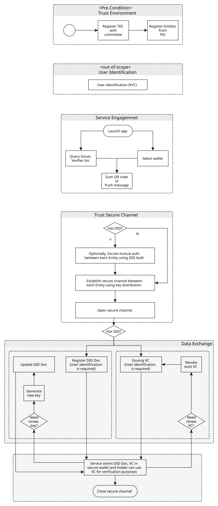
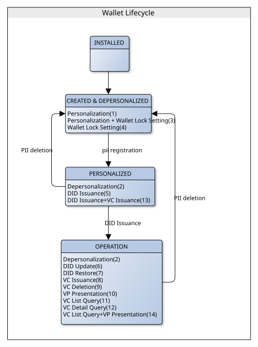
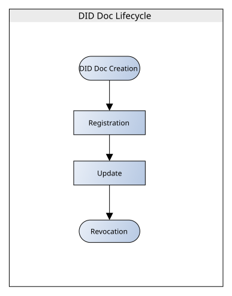
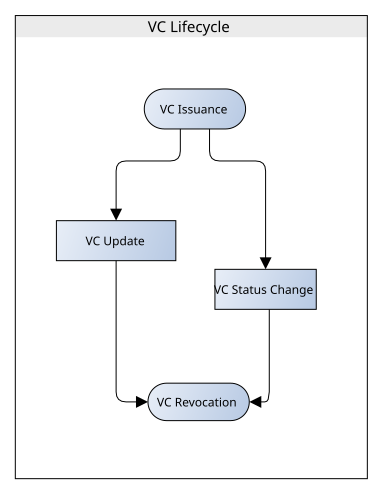
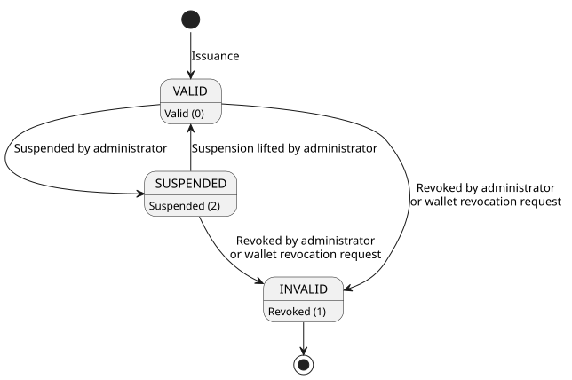

# Wallet Life Cycle

- Subject: Wallet Life Cycle
- Author: OpenSource Development Team
- Date: 2026-10-22
- Version: v1.1.0

| Version | Date       | Changes         |
| ------- | ---------- | --------------- |
| v1.1.0  | 2026-10-22 | Add OID4VCI Credential lifecycle |
| v1.0.1  | 2026-10-13 | Revise wording  |
| v1.0.0  | 2024-10-18 | Initial version |

 

The diagram below illustrates a typical workflow supported by the OpenDID protocol. Specific workflows are determined by issuance policies, and users proceed through registration steps, service connections, and application execution to securely store DID Documents and VCs within their wallets.

A Wallet, DID Document, and VC each have their own lifecycle. For more details, please refer to the following detailed descriptions.

## Detailed Lifecycle Description
The wallet undergoes a **4-stage lifecycle**.
 

### 1. Wallet Lifecycle States
* `INSTALLED`
* `CREATED & DEPERSONALIZED`
* `PERSONALIZED`
* `OPERATION`

#### - INSTALLED
Indicates the state of wallet app installation.

#### - CREATED & DEPERSONALIZED
Signifies wallet creation (DB, file) without user binding.
 
User binding (PII registration) and wallet locking functionality can be optionally combined.

#### - PERSONALIZED
State where user information is bound, enabling DID issuance and VC issuance.
 
If user information (PII) is deleted, wallet reverts to stage 2 (CREATED & DEPERSONALIZED).

#### - OPERATION
State where DID is issued, allowing all DID/VC related functionalities.
 
Upon deletion of user information (PII), the wallet status changes to stage 2 (CREATED & DEPERSONALIZED).

---

### 2. DID Lifecycle
DID undergoes a **5-stage lifecycle**.
 

<!-- Spacing for line break -->

### * DID Document Lifecycle States
* `DID Document Registration`
* `DID Document Update`
* `DID Document State Change`
* `DID Document Revocation`
* `DID Document Termination`
 

#### - DID Document Registration
Initial issuance of DID Document.
 
This function is requested by CA, Entity.

#### - DID Document Update
Update of DID Document caused by key addition, SEP addition.
 
This function is requested by CA, Entity.

#### - DID Document State Change
Activation/Deactivation of DID Document.
 
This function is requested by TAS.

#### - DID Document Revocation
Revocation of DID Document (used for purposes like denial prevention).
 
This function is requested by TAS.

#### - DID Document Termination
Termination of DID Document (rendering it unusable for any purpose).
 
This function is requested by TAS.

---
### 3. VC Lifecycle
VC (Verifiable Credential) undergoes a **4-stage lifecycle**.
 

<!-- Spacing for line break -->

### * VC Lifecycle States
* `VC Issuance`
* `VC Reissuance`
* `VC State Change`
* `VC Revocation`
 

#### - VC Issuance
Initial issuance of VC (Verifiable Credential).
 
This function is requested by CA.

#### - VC Reissuance
Reissuance of VC (Verifiable Credential).
 
This function is requested by CA.

#### - VC State Change
Activation/Deactivation of VC (Verifiable Credential).
 
This function is requested by Issuer.

#### - VC Revocation
Revocation of VC (Verifiable Credential).
 
This function is requested by Issuer.

> *ZKP(Zero-Knowledge Proof)-based credential follow the data structure and trust model of VC(Verifiable Credential), and are operated in accordance with the VC's lifecycle management policies. Therefore, ZKP credential also follow the same lifecycle stages as VC.

---
### 4. OID4VCI Credential Lifecycle
Credentials issued through OID4VCI (SD-JWT VC, mdoc) are managed with the Token Status List and have **3 states**.
 

<!-- Spacing for line break -->

### * OID4VCI Credential Lifecycle States
* `Credential Issuance`
* `Credential State Change`
* `Credential Revocation`
 

#### - Credential Issuance
When the wallet requests a Credential through OID4VCI, the Credential Issuer assigns an index in the Status List and issues the Credential in the `VALID` state.
 
This function is requested by the Wallet.

#### - Credential State Change
Suspends the Credential (`SUSPENDED`) or lifts the suspension (`VALID`).
 
This function is requested by the Issuer administrator.

#### - Credential Revocation
Revokes the Credential (`INVALID`). A revoked Credential cannot be made valid again.
 
This function is requested by the Issuer administrator or the Wallet.

The state names differ from those of the VC lifecycle, but their meanings correspond as follows.

| VC State   | OID4VCI Credential State | Description                                          |
| ---------- | ------------------------ | ---------------------------------------------------- |
| `ACTIVE`   | `VALID`                  | Usable                                               |
| `INACTIVE` | `SUSPENDED`              | Temporarily suspended; can return to the normal state |
| `REVOKED`  | `INVALID`                | Revoked; cannot transition to any other state        |

> *The Verifier checks the state by retrieving the Status List Token with the Status List URI and index included in the Credential. Expiration is not a Status List state; it is determined by the validity period of the Credential (`exp` for SD-JWT VC, `validUntil` for mdoc). For details, refer to [OID4VCI Issuance](OID4VCI%20Issuance.md#5-credential-status-management).
