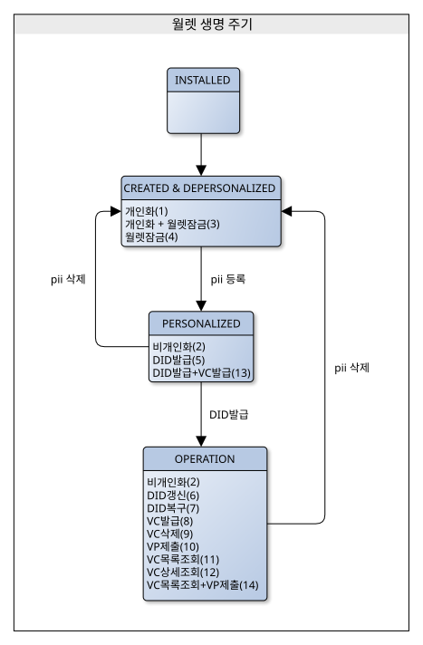
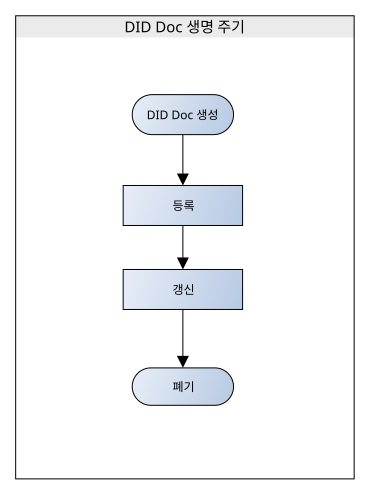
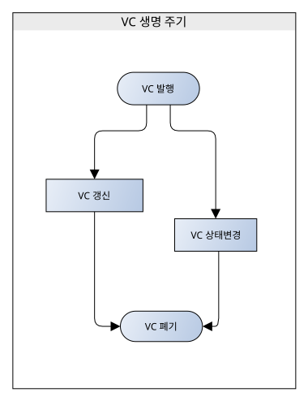

# Wallet 생명 주기

- 주제 : Wallet 생명 주기
- 작성 : 오픈소스개발팀
- 일자 : 2026-10-22
- 버전 : v1.1.0

| 버전 | 일자       | 변경         |
| ------- | ---------- | --------------- |
| v1.1.0  | 2026-10-22 | OID4VCI Credential 생명 주기 추가 |
| v1.0.1  | 2026-10-13 | 오타 수정, 문구 수정 |
| v1.0.0  | 2024-10-18 | 최초 작성 |

 

아래 그림은 OpenDID 프로토콜에서 지원하는 일반적인 작업 흐름을 말합니다. 구체적인 작업 흐름은 발급 정책에 따라 결정되며 사용자는 월렛을 설치하고 DID/VC 발급 과정까지 각 단계별 등록 절차 및 서비스 연결 그리고 어플리케이션을 실행하여 안전한 통신 채널 하에 월렛에 DID Document, VC를 저장합니다.

월렛과 DID Document, VC는 각각의 생명주기를 가지며 자세한 내용은 아래 상세설명을 참고하세요.

## 생명주기 상세 설명
월렛은 생명 **주기별 4단계** 상태를 가진다.
 

### 1. 월렛 생명 주기별 상태
* `INSTALLED`
* `CREATED & DEPERSONALIZED`
* `PERSONALIZED`
* `OPERATION`

#### - INSTALLED
월렛 앱 설치 상태를 의미

#### - CREATED & DEPERSONALIZED
월렛 생성(DB, file)과 사용자가 바인딩 되지 않은 상태 의미
 
사용자 바인딩(PII등록)과 월렛 잠금 기능은 부가적으로 함께 사용 가능

#### - PERSONALIZED
사용자 정보가 바인딩 된 상태로 DID발급 및 VC발급 수행 가능
 
사용자 정보(PII) 삭제 시 2번(CREATED & DEPERSONALIZED) 단계로 월렛 상태 변경

#### - OPERATION
DID가 발급된 상태며 DID/ VC 관련 모든 기능을 수행 가능
 
사용자 정보(PII) 삭제 시 2번(CREATED & DEPERSONALIZED) 단계로 월렛 상태 변경  
 

---

### 2. DID 생명 주기
DID는 생명 **주기별 5단계** 상태를 가진다.
 

<!-- 한줄 띄기 입니다. -->

### * DID Document 생명 주기별 상태
* `DID Document 등록`
* `DID Document 갱신`
* `DID Document 상태 변경`
* `DID Document 폐기`
* `DID Document 말소`
 

#### - DID Document 등록
DID Document를 초기 발급한다.
 
해당 기능은 CA, Entity가 요청

#### - DID Document 갱신
키 추가, SEP 추가 등의 이유로 DID Document를 갱신한다.
 
해당 기능은 CA, Entity가 요청

#### - DID Document 상태변경
DID Document를 활성화/ 비활성화 시킨다.
 
해당 기능은 TAS가 요청

#### - DID Document 폐기
DID Document를  폐기한다 (부인방지 목적 등으로 사용 가능)
 
해당 기능은 TAS가 요청

#### - DID Doc 말소
DID Document를 말소한다. (어떠한 목적으로도 사용 불가능)
 
해당 기능은 TAS가 요청

---

### 3. VC 생명 주기
VC(Verifiable Credential)는 생명 **주기별 4단계** 상태를 가진다.
 

<!-- 한줄 띄기 입니다. -->

### * VC 생명 주기별 상태
* `VC 발행`
* `VC 재발급`
* `VC 상태변경`
* `VC 폐기`
 

#### - VC 발행
VC(Verifiable Credential)를 초기 발급한다.
 
해당기능은 CA가 요청

#### - VC 재발급
VC(Verifiable Credential)를 재발급한다.
 
해당기능은 CA가 요청

#### - VC 상태변경
VC(Verifiable Credential)를 활성화/ 비활성 시킨다.
 
해당기능은 Issuer가 요청

#### - VC 폐기
VC(Verifiable Credential)를 폐기한다.
 
해당기능은 Issuer가 요청

> *ZKP(Zero-Knowledge Proof) 기반 Credential은 VC(Verifiable Credential)의 데이터 구조와 신뢰 모델을 따르며, VC의 생명주기 관리 정책에 종속적으로 운용됩니다. 따라서, ZKP Credential 역시 VC와 동일한 생명주기 단계를 따릅니다.

---
### 4. OID4VCI Credential 생명 주기
OID4VCI로 발급한 Credential(SD-JWT VC, mdoc)은 Token Status List로 상태를 관리하며 **3가지** 상태를 가진다.
 

<!-- 한줄 띄기 입니다. -->

### * OID4VCI Credential 생명 주기별 상태
* `Credential 발급`
* `Credential 상태변경`
* `Credential 폐기`
 

#### - Credential 발급
월렛이 OID4VCI로 Credential을 요청하면 Credential Issuer는 Status List의 index를 할당하고 `VALID` 상태로 Credential을 발급한다.
 
해당기능은 월렛이 요청

#### - Credential 상태변경
Credential을 일시 정지(`SUSPENDED`)하거나 정지를 해제(`VALID`)한다.
 
해당기능은 Issuer 관리자가 요청

#### - Credential 폐기
Credential을 폐기(`INVALID`)한다. 폐기한 Credential은 다시 유효하게 할 수 없다.
 
해당기능은 Issuer 관리자 또는 월렛이 요청

VC 생명 주기와 상태 이름은 다르지만 의미는 다음과 같이 대응한다.

| VC 상태    | OID4VCI Credential 상태 | 설명                                  |
| ---------- | ----------------------- | ------------------------------------- |
| `ACTIVE`   | `VALID`                 | 사용 가능                             |
| `INACTIVE` | `SUSPENDED`             | 일시 정지, 정상 상태로 복귀 가능      |
| `REVOKED`  | `INVALID`               | 폐기, 다른 상태로 변경 불가           |

> *검증자는 Credential에 포함된 Status List URI와 index로 Status List Token을 조회하여 상태를 확인한다. 유효기간 만료는 Status List의 상태가 아니며, Credential의 유효기간(SD-JWT VC의 `exp`, mdoc의 `validUntil`)으로 판단한다. 자세한 내용은 [OID4VCI 발급](OID4VCI%20Issuance_ko.md#5-credential-상태-관리)을 참조한다.
