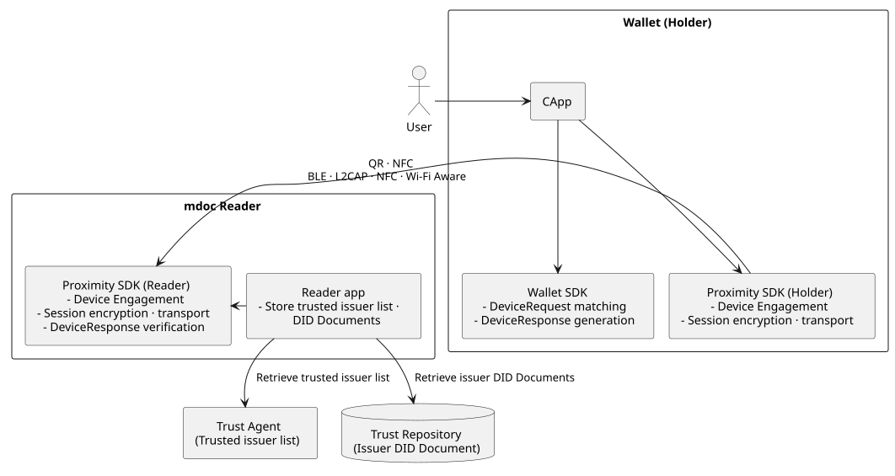
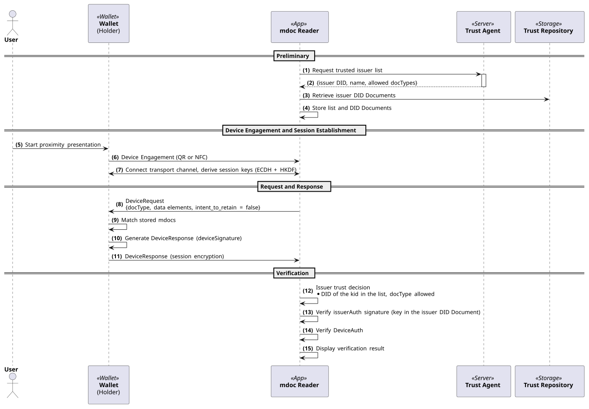

---
puppeteer:
    pdf:
        format: A4
        displayHeaderFooter: true
        landscape: false
        scale: 0.8
        margin:
            top: 1.2cm
            right: 1cm
            bottom: 1cm
            left: 1cm
    image:
        quality: 100
        fullPage: false
---

mdoc Proximity Presentation
==

- Subject: Explanation of ISO/IEC 18013-5-based mdoc Proximity Presentation Concept
- Author: OpenSource Development Team
- Date: 2026-11-04
- Version: v1.0.0

| Version | Date       | Changes         |
| ------- | ---------- | --------------- |
| v1.0.0  | 2026-11-04 | Initial version |

 

Table of Contents
---

<!-- TOC tocDepth:2..4 chapterDepth:2..6 -->

- [1. Overview](#1-overview)
    - [1.1. Reference Documents](#11-reference-documents)
    - [1.2. Terminology](#12-terminology)
    - [1.3. Comparison with OID4VP Presentation](#13-comparison-with-oid4vp-presentation)
- [2. Components](#2-components)
    - [2.1. Role Split between SDKs](#21-role-split-between-sdks)
- [3. Preliminary Procedures](#3-preliminary-procedures)
    - [3.1. mdoc Issuance](#31-mdoc-issuance)
    - [3.2. Trusted Issuer List](#32-trusted-issuer-list)
- [4. Presentation Procedures](#4-presentation-procedures)
    - [4.1. Device Engagement](#41-device-engagement)
    - [4.2. Session Establishment](#42-session-establishment)
    - [4.3. DeviceRequest and Matching](#43-devicerequest-and-matching)
    - [4.4. DeviceResponse](#44-deviceresponse)
    - [4.5. Verification by the mdoc Reader](#45-verification-by-the-mdoc-reader)
    - [4.6. Timeouts](#46-timeouts)
- [5. Implementation Scope and Constraints](#5-implementation-scope-and-constraints)
    - [5.1. Support by OS](#51-support-by-os)
    - [5.2. Unsupported Features](#52-unsupported-features)

<!-- /TOC -->

## 1. Overview

This document describes the overall concept of ISO/IEC 18013-5-based mdoc proximity presentation supported in OpenDID 3.0.
In proximity presentation, the wallet and the mdoc reader exchange an mdoc over short-range communication (BLE, NFC, etc.) without going through the internet.

The mdoc proximity presentation proceeds in the following order.

1. Preliminary procedures
    - (A) mdoc issuance - Issue an mdoc bound to the device key through OID4VCI
    - (B) Trusted issuer list - The mdoc reader receives the trusted issuer list and the issuer DID Documents in advance
1. Presentation procedures
    - (C) Device Engagement - Exchange connection information through a QR code or NFC
    - (D) Session establishment - Connect the transport channel and derive the session encryption keys
    - (E) DeviceRequest and matching - Find the mdoc that matches the requested document and elements
    - (F) DeviceResponse - Generate and send the presentation data
    - (G) Verification - Issuer trust decision and signature verification by the mdoc reader

### 1.1. Reference Documents

| Reference Name         | Document Title                                           | Location |
| ---------------------- | -------------------------------------------------------- | -------- |
| [ISO-18013-5]          | ISO/IEC 18013-5 Mobile driving licence (mDL) application | https://www.iso.org/standard/69084.html |
| [MDOC-FORMAT]          | (OpenDID) mdoc format                                    | [mdoc format.md](../data%20standard/oid4vc%20credential%20format/mdoc%20format.md) |
| [OID4VCI-ISSUANCE]     | (OpenDID) OID4VCI-based VC Issuance                      | [OID4VCI Issuance.md](OID4VCI%20Issuance.md) |
| [OID4VP-PRESENTATION]  | (OpenDID) OID4VP-based VP Presentation                   | [OID4VP Presentation.md](OID4VP%20Presentation.md) |
| [PRESENT-MDOC-SEQ]     | (OpenDID) mdoc Proximity Presentation Sequence (P330)    | [P330_mdoc_proximity_present.puml](../sequence/detailed/P330_mdoc_proximity_present.puml) |

### 1.2. Terminology

| Term | Description |
| ---- | ----------- |
| mdoc | A Credential in the mobile document format defined in ISO/IEC 18013-5 ([MDOC-FORMAT]) |
| mdoc reader | An app that requests and verifies an mdoc through proximity presentation |
| Holder | The wallet that stores and presents an mdoc |
| Device Engagement | The step in which the holder and the mdoc reader exchange connection methods and session key exchange information |
| Handover | A method of delivering Device Engagement information over NFC. There are static and negotiated handovers. |
| SessionTranscript | Data that identifies the session. It is used to derive the session keys and to sign DeviceAuth. |
| DeviceRequest | The documents (docType) and data elements requested by the mdoc reader |
| DeviceResponse | The mdoc data presented by the holder |
| issuerAuth | The issuer's signature on the mdoc |
| DeviceAuth | The value with which the holder authenticates the DeviceResponse using the device key |

### 1.3. Comparison with OID4VP Presentation

| Category | OID4VP Presentation ([OID4VP-PRESENTATION]) | mdoc Proximity Presentation |
| -------- | ------------------------------------------- | --------------------------- |
| Communication | Internet (`request_uri`, `response_uri`) | Short-range communication (BLE, NFC, Wi-Fi Aware) |
| Initiation | QR, deep link `openid4vp://` | Device Engagement (QR, NFC) |
| Request information | Request Object signed by the verifier (DCQL) | DeviceRequest |
| Secure channel | TLS, (optional) response JWE encryption | Session encryption |
| Credential formats | SD-JWT VC, ISO mdoc, OpenDID VC | ISO mdoc |
| Verifying entity | Verifier server | mdoc reader app |

## 2. Components

The components of mdoc proximity presentation are shown in the figure below.

| Component | Role |
| --------- | ---- |
| Wallet (holder) | Stores mdocs, and generates and presents a DeviceResponse that matches the request of the mdoc reader. |
| mdoc reader app | Sends a DeviceRequest and verifies the received DeviceResponse. |
| Trust Agent | Provides the trusted issuer list to the mdoc reader. |
| Trust Repository | Provides the issuer DID Documents. The mdoc reader verifies issuerAuth with a key in this DID Document. |

### 2.1. Role Split between SDKs

The wallet and the mdoc reader app use the following SDKs.

| Category | SDK | Role |
| -------- | --- | ---- |
| Wallet | Wallet SDK | DeviceRequest matching, DeviceResponse generation |
| Wallet | Proximity SDK (holder) | Device Engagement, session encryption, transport |
| mdoc reader app | Proximity SDK (reader) | Device Engagement, session encryption, transport, DeviceResponse verification |

## 3. Preliminary Procedures

### 3.1. mdoc Issuance

The mdoc used for proximity presentation is issued through OID4VCI (refer to [OID4VCI-ISSUANCE]).
The mdoc is bound to the device key of the wallet, and the wallet verifies the digests, the validity period, and the device key binding of the issued mdoc before storing it.

### 3.2. Trusted Issuer List

The mdoc reader receives the trusted issuer list from the Trust Agent. Each entry of the list contains the following information.

| Item | Description |
| ---- | ----------- |
| Issuer DID | DID of a trusted issuer |
| Name | Display name of the issuer |
| Allowed docTypes | List of document types that the issuer is allowed to issue |

- The mdoc reader receives the DID Document of each issuer together with the list and stores (caches) them.
- The stored information is replaced only when both the list and the DID Documents are received. Otherwise, the existing information remains in use.
- Verification uses only the stored information without network access.

## 4. Presentation Procedures

The overall flow of mdoc proximity presentation is shown in the figure below. For the detailed procedure, refer to [PRESENT-MDOC-SEQ].

### 4.1. Device Engagement

The holder and the mdoc reader exchange Device Engagement information in the following ways.

| Method | Description |
| ------ | ----------- |
| QR | The holder displays the Device Engagement information as a QR code, and the mdoc reader scans it. |
| NFC static handover | The holder delivers predefined connection information over NFC. |
| NFC negotiated handover | The holder and the mdoc reader negotiate the connection method over NFC. |

For support by OS, refer to 5.1.

### 4.2. Session Establishment

After Device Engagement, the holder and the mdoc reader connect through one of the following transports.

| Transport | Description |
| --------- | ----------- |
| BLE | GATT-based transport. Both the central (client) and peripheral (server) roles are supported. |
| L2CAP | Transport over a BLE L2CAP channel |
| NFC | NFC data transfer |
| Wi-Fi Aware | Wi-Fi Aware transport |

- The wallet can configure the BLE role (central / peripheral), and both roles are used by default.
- Session data is encrypted with session keys derived by HKDF from a secret shared through ECDH ([ISO-18013-5]).

### 4.3. DeviceRequest and Matching

The mdoc reader sends a DeviceRequest that contains the documents (docType) and data elements to request.

- The mdoc reader sets `intent_to_retain` to `false` in the request, meaning that it does not retain the received data.
- The wallet matches the DeviceRequest against the stored mdocs with the Wallet SDK.

### 4.4. DeviceResponse

The wallet generates the DeviceResponse with the Wallet SDK, and the Proximity SDK encrypts it with the session keys and sends it.

- DeviceAuth uses `deviceSignature` (signature with the device key).

### 4.5. Verification by the mdoc Reader

The mdoc reader verifies each presented document in the following order.

1. Check that the `kid` in the issuerAuth signature header is a DID URL.
2. Check that the DID of the `kid` is in the trusted issuer list.
3. Check that the docType of the document is in the allowed docTypes of that issuer.
4. Find the public key referenced by the `kid` in the stored issuer DID Document.
5. Verify the issuerAuth signature with that public key.
6. Verify DeviceAuth (`deviceSignature` or `deviceMac`).

The issuer is trusted only when steps 1 through 5 all pass.
As the verification result, the mdoc reader displays whether the issuer is trusted, the DeviceAuth result, the validity period, and the presented data elements.

### 4.6. Timeouts

| Role | Timeout |
| ---- | ------- |
| Holder | 60 seconds |
| mdoc reader | 120 seconds |

## 5. Implementation Scope and Constraints

### 5.1. Support by OS

| Item | iOS wallet | Android wallet | iOS mdoc reader | Android mdoc reader |
| ---- | ---------- | -------------- | --------------- | ------------------- |
| QR engagement | O | O | O | O |
| NFC static handover | X | O | O | O |
| NFC negotiated handover | X | X | O | O |
| BLE (central / peripheral) | O | O | O | O |
| L2CAP | O | O | O | O |
| NFC data transfer | X | O | O | O |
| Wi-Fi Aware | X | O | X | O |

- The iOS wallet does not support NFC engagement or NFC data transfer. The iOS Proximity SDK provides only an extension point through which the app can inject NFC card emulation.
- Wi-Fi Aware on Android is supported on API level 29 or higher.

### 5.2. Unsupported Features

| Item | Current Behavior |
| ---- | ---------------- |
| mdoc reader authentication (readerAuth) | The mdoc reader does not generate readerAuth. |
| Online presentation (ISO/IEC 18013-7) | Not supported. |
| Server retrieval | Not supported. |
