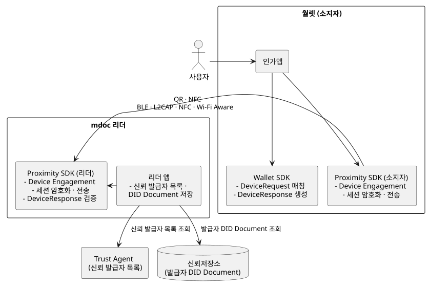
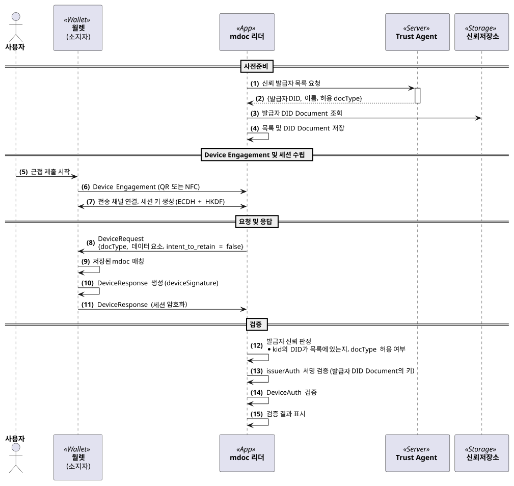

---
puppeteer:
    pdf:
        format: A4
        displayHeaderFooter: true
        landscape: false
        scale: 0.8
        margin:
            top: 1.2cm
            right: 1cm
            bottom: 1cm
            left: 1cm
    image:
        quality: 100
        fullPage: false
---

mdoc 근접 제출
==

- 주제: ISO/IEC 18013-5 기반 mdoc 근접 제출 개념 설명
- 작성: 오픈소스개발팀
- 일자: 2026-11-04
- 버전: v1.0.0

| 버전   | 일자       | 변경 내용 |
| ------ | ---------- | --------- |
| v1.0.0 | 2026-11-04 | 초안      |

 

목차
---

<!-- TOC tocDepth:2..4 chapterDepth:2..6 -->

- [1. 개요](#1-개요)
    - [1.1. 참조문서](#11-참조문서)
    - [1.2. 용어](#12-용어)
    - [1.3. OID4VP 제출과의 비교](#13-oid4vp-제출과의-비교)
- [2. 구성 요소](#2-구성-요소)
    - [2.1. SDK 역할 분담](#21-sdk-역할-분담)
- [3. 사전준비 절차](#3-사전준비-절차)
    - [3.1. mdoc 발급](#31-mdoc-발급)
    - [3.2. 신뢰 발급자 목록](#32-신뢰-발급자-목록)
- [4. 제출 절차](#4-제출-절차)
    - [4.1. Device Engagement](#41-device-engagement)
    - [4.2. 세션 수립](#42-세션-수립)
    - [4.3. DeviceRequest 및 매칭](#43-devicerequest-및-매칭)
    - [4.4. DeviceResponse](#44-deviceresponse)
    - [4.5. mdoc 리더의 검증](#45-mdoc-리더의-검증)
    - [4.6. 타임아웃](#46-타임아웃)
- [5. 구현 범위 및 제약](#5-구현-범위-및-제약)
    - [5.1. OS별 지원 범위](#51-os별-지원-범위)
    - [5.2. 미지원 기능](#52-미지원-기능)

<!-- /TOC -->

## 1. 개요

본 문서는 OpenDID 3.0에서 지원하는 ISO/IEC 18013-5 기반 mdoc 근접 제출의 전반적인 개념을 설명한다.
근접 제출은 월렛과 mdoc 리더가 인터넷을 거치지 않고 근거리 통신(BLE, NFC 등)으로 mdoc을 주고받는 방식이다.

mdoc 근접 제출 순서는 다음과 같다.

1. 사전준비 절차
    - (A) mdoc 발급 - OID4VCI로 기기 키에 바인딩된 mdoc 발급
    - (B) 신뢰 발급자 목록 - mdoc 리더가 신뢰 발급자 목록과 발급자 DID Document를 미리 수신
1. 제출 절차
    - (C) Device Engagement - QR 또는 NFC로 연결 정보 교환
    - (D) 세션 수립 - 전송 채널 연결, 세션 암호화 키 생성
    - (E) DeviceRequest 및 매칭 - 요청된 문서와 요소에 맞는 mdoc 탐색
    - (F) DeviceResponse - 제출 데이터 생성 및 전송
    - (G) 검증 - mdoc 리더의 발급자 신뢰 판정 및 서명 검증

### 1.1. 참조문서

| 참조명                 | 문서명                                                   | 위치 |
| ---------------------- | -------------------------------------------------------- | ---- |
| [ISO-18013-5]          | ISO/IEC 18013-5 Mobile driving licence (mDL) application | https://www.iso.org/standard/69084.html |
| [MDOC-FORMAT]          | (OpenDID) mdoc format                                    | [mdoc format_ko.md](./../data%20standard/oid4vc%20credential%20format/mdoc%20format_ko.md) |
| [OID4VCI-ISSUANCE]     | (OpenDID) OID4VCI 기반 VC 발급                           | [OID4VCI Issuance_ko.md](OID4VCI%20Issuance_ko.md) |
| [OID4VP-PRESENTATION]  | (OpenDID) OID4VP 기반 VP 제출                            | [OID4VP Presentation_ko.md](OID4VP%20Presentation_ko.md) |
| [PRESENT-MDOC-SEQ]     | (OpenDID) mdoc 근접 제출 절차도 (P330)                   | [P330_mdoc_proximity_present_ko.puml](../sequence/detailed/P330_mdoc_proximity_present_ko.puml) |

### 1.2. 용어

| 용어 | 설명 |
| ---- | ---- |
| mdoc | ISO/IEC 18013-5에 정의된 모바일 문서 형식의 Credential ([MDOC-FORMAT]) |
| mdoc 리더 | 근접 제출로 mdoc을 요청하고 검증하는 앱 |
| 소지자 | mdoc을 보관하고 제출하는 월렛 |
| Device Engagement | 소지자와 mdoc 리더가 연결 방식과 세션 키 교환 정보를 주고받는 단계 |
| Handover | NFC로 Device Engagement 정보를 전달하는 방식. static과 negotiated가 있다. |
| SessionTranscript | 세션을 식별하는 데이터. 세션 키 생성과 DeviceAuth 서명에 사용한다. |
| DeviceRequest | mdoc 리더가 요청하는 문서(docType)와 데이터 요소 |
| DeviceResponse | 소지자가 제출하는 mdoc 데이터 |
| issuerAuth | 발급자가 mdoc에 한 서명 |
| DeviceAuth | 소지자가 기기 키로 DeviceResponse를 인증한 값 |

### 1.3. OID4VP 제출과의 비교

| 구분 | OID4VP 제출 ([OID4VP-PRESENTATION]) | mdoc 근접 제출 |
| ---- | ----------------------------------- | -------------- |
| 통신 | 인터넷 (`request_uri`, `response_uri`) | 근거리 통신 (BLE, NFC, Wi-Fi Aware) |
| 제출 개시 | QR, 딥링크 `openid4vp://` | Device Engagement (QR, NFC) |
| 요청 정보 | 검증자가 서명한 Request Object (DCQL) | DeviceRequest |
| 보안 채널 | TLS, (선택) 응답 JWE 암호화 | 세션 암호화 |
| Credential 형식 | SD-JWT VC, ISO mdoc, OpenDID VC | ISO mdoc |
| 검증 주체 | Verifier 서버 | mdoc 리더 앱 |

## 2. 구성 요소

mdoc 근접 제출의 구성 요소는 아래 그림과 같다.

| 구성 요소 | 역할 |
| --------- | ---- |
| 월렛 (소지자) | mdoc을 보관하고, mdoc 리더의 요청에 맞는 DeviceResponse를 생성하여 제출한다. |
| mdoc 리더 앱 | DeviceRequest를 보내고, 받은 DeviceResponse를 검증한다. |
| Trust Agent | mdoc 리더에 신뢰 발급자 목록을 제공한다. |
| 신뢰저장소 | 발급자 DID Document를 제공한다. mdoc 리더는 이 DID Document의 키로 issuerAuth를 검증한다. |

### 2.1. SDK 역할 분담

월렛과 mdoc 리더 앱은 다음 SDK를 사용한다.

| 구분 | SDK | 역할 |
| ---- | --- | ---- |
| 월렛 | Wallet SDK | DeviceRequest 매칭, DeviceResponse 생성 |
| 월렛 | Proximity SDK (소지자) | Device Engagement, 세션 암호화, 전송 |
| mdoc 리더 앱 | Proximity SDK (리더) | Device Engagement, 세션 암호화, 전송, DeviceResponse 검증 |

## 3. 사전준비 절차

### 3.1. mdoc 발급

근접 제출에 사용하는 mdoc은 OID4VCI로 발급받는다([OID4VCI-ISSUANCE] 참조).
mdoc은 월렛의 기기 키에 바인딩되며, 월렛은 발급받은 mdoc의 digest, 유효기간, 기기 키 바인딩을 검증한 뒤 저장한다.

### 3.2. 신뢰 발급자 목록

mdoc 리더는 Trust Agent에서 신뢰 발급자 목록을 받는다. 목록의 각 항목은 다음 정보를 담는다.

| 항목 | 설명 |
| ---- | ---- |
| 발급자 DID | 신뢰하는 발급자의 DID |
| 이름 | 발급자 표시 이름 |
| 허용 docType | 해당 발급자가 발급할 수 있는 문서 유형 목록 |

- mdoc 리더는 목록과 함께 각 발급자의 DID Document를 받아 저장(캐시)한다.
- 목록과 DID Document를 모두 받은 경우에만 저장된 정보를 교체한다. 받지 못하면 기존 정보를 그대로 사용한다.
- 검증 시에는 네트워크를 사용하지 않고 저장된 정보만 사용한다.

## 4. 제출 절차

mdoc 근접 제출의 전체 흐름은 아래 그림과 같다. 상세 절차는 [PRESENT-MDOC-SEQ]를 참조한다.

### 4.1. Device Engagement

소지자와 mdoc 리더는 다음 방식으로 Device Engagement 정보를 교환한다.

| 방식 | 설명 |
| ---- | ---- |
| QR | 소지자가 Device Engagement 정보를 QR로 표시하고 mdoc 리더가 읽는다. |
| NFC static handover | 소지자가 정해진 연결 정보를 NFC로 전달한다. |
| NFC negotiated handover | 소지자와 mdoc 리더가 NFC로 연결 방식을 협상한다. |

OS별 지원 범위는 5.1을 참조한다.

### 4.2. 세션 수립

Device Engagement 후 소지자와 mdoc 리더는 다음 전송 방식 중 하나로 연결한다.

| 전송 방식 | 설명 |
| --------- | ---- |
| BLE | GATT 기반 전송. central(클라이언트)과 peripheral(서버) 역할을 모두 지원한다. |
| L2CAP | BLE L2CAP 채널 전송 |
| NFC | NFC 데이터 전송 |
| Wi-Fi Aware | Wi-Fi Aware 전송 |

- 월렛은 BLE 역할(central / peripheral)을 설정할 수 있으며, 기본값은 두 역할을 모두 사용하는 것이다.
- 세션 데이터는 ECDH로 공유한 비밀과 HKDF로 생성한 세션 키로 암호화한다([ISO-18013-5]).

### 4.3. DeviceRequest 및 매칭

mdoc 리더는 요청할 문서(docType)와 데이터 요소를 담은 DeviceRequest를 보낸다.

- mdoc 리더는 요청 시 `intent_to_retain`을 `false`로 설정한다. 받은 데이터를 보관하지 않는다는 의미이다.
- 월렛은 Wallet SDK로 DeviceRequest를 저장된 mdoc과 매칭한다.

### 4.4. DeviceResponse

월렛은 Wallet SDK로 DeviceResponse를 생성하고, Proximity SDK가 세션 키로 암호화하여 전송한다.

- DeviceAuth는 `deviceSignature`(기기 키 서명)를 사용한다.

### 4.5. mdoc 리더의 검증

mdoc 리더는 제출된 문서마다 다음 순서로 검증한다.

1. issuerAuth 서명 헤더의 `kid`가 DID URL인지 확인한다.
2. `kid`의 DID가 신뢰 발급자 목록에 있는지 확인한다.
3. 문서의 docType이 해당 발급자의 허용 docType에 있는지 확인한다.
4. 저장된 발급자 DID Document에서 `kid`가 가리키는 공개키를 찾는다.
5. 찾은 공개키로 issuerAuth 서명을 검증한다.
6. DeviceAuth(`deviceSignature` 또는 `deviceMac`)를 검증한다.

1~5를 모두 통과해야 발급자를 신뢰하는 것으로 판정한다.
mdoc 리더는 검증 결과로 발급자 신뢰 여부, DeviceAuth 결과, 유효기간, 제출된 데이터 요소를 표시한다.

### 4.6. 타임아웃

| 역할 | 타임아웃 |
| ---- | -------- |
| 소지자 | 60초 |
| mdoc 리더 | 120초 |

## 5. 구현 범위 및 제약

### 5.1. OS별 지원 범위

| 항목 | iOS 월렛 | Android 월렛 | iOS mdoc 리더 | Android mdoc 리더 |
| ---- | -------- | ------------ | ------------- | ----------------- |
| QR engagement | O | O | O | O |
| NFC static handover | X | O | O | O |
| NFC negotiated handover | X | X | O | O |
| BLE (central / peripheral) | O | O | O | O |
| L2CAP | O | O | O | O |
| NFC 데이터 전송 | X | O | O | O |
| Wi-Fi Aware | X | O | X | O |

- iOS 월렛은 NFC engagement와 NFC 데이터 전송을 지원하지 않는다. iOS Proximity SDK는 앱이 NFC 카드 에뮬레이션을 주입할 수 있는 확장점만 제공한다.
- Android의 Wi-Fi Aware는 API 레벨 29 이상에서 지원한다.

### 5.2. 미지원 기능

| 항목 | 현재 동작 |
| ---- | --------- |
| mdoc 리더 인증 (readerAuth) | mdoc 리더는 readerAuth를 생성하지 않는다. |
| 온라인 제출 (ISO/IEC 18013-7) | 지원하지 않는다. |
| Server retrieval | 지원하지 않는다. |
