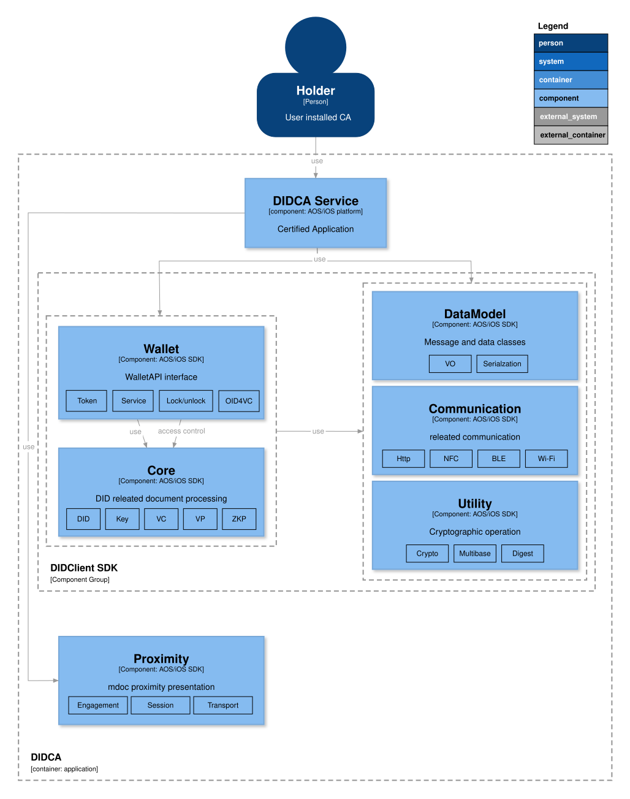
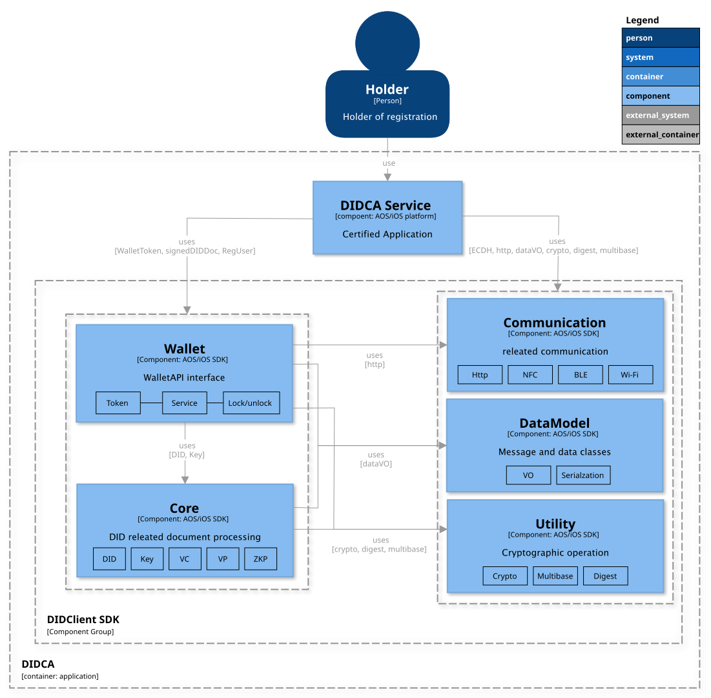

<!-- Individual documents may be merged in the future, so the table of contents is not used. -->
# 월렛 소프트웨어 아키텍쳐

- 주제 : 월렛 소프트웨어 아키텍쳐
- 작성 : 오픈소스개발팀
- 일자 : 2026-11-04
- 버전 : v2.1.0

| 버전     | 일자         | 변경                       |
|--------|------------|--------------------------|
| v2.1.0 | 2026-11-04 | OID4VC 기능 및 Proximity SDK 추가, 오타 수정 |
| v2.0.0 | 2025-06-23 | ZKP 내용 추가 및 SDK 통합 내용 반영 |
| v1.0.0 | 2024-10-18 | 최초 작성                    |

 

CA(Certified App)는 신뢰 가능한 월렛 기능을 제공하기 위해서 유저 등록, VC 발급(ZKP 포함), VP 제출, ZKP 제출 등 Wallet, Utility, Communication, DataModel 컴포넌트를 참조하여 각 프로토콜 별 기능을 구현할 수 있다.

### 1. 컴포넌트 설명
상기 SDK구조는 OpenDID의 클라이언트의 인가앱과 월렛 소프트웨어 관계 구조도이며 아래는 각 컴포넌트별 대표 클래스를 설명한다.

- Wallet
  - Open DID에 필요한 WalletToken, Lock/Unlock, Key, DID Document(DID 문서), Verifiable Credential(이하 VC), Zero-knowledge Proof(이하 ZKP) 정보를 생성 및 보관, 관리하는 기능을 제공한다.
- Core
  - Open DID에 필요한 Key, DID Document(DID 문서), Verifiable Credential(이하 VC), Zero-knowledge Proof(이하 ZKP) 정보를 생성 및 보관, 관리하는 기능을 제공한다.
- Communication 
  - 통신 인터페이스를 제공하여 HTTP 요청 및 응답을 관리하며, GET과 POST 메서드와 JSON payload를 지원한다.
- Utility
  - 다양한 암호화 및 인코딩, 해싱 기능을 제공한다.
- DataModel
  - 앱과 월렛 SDK에서 사용된 데이터 모델을 정의한다.

| 컴포넌트 그룹       | 클래스             | 기능                                                                  |
|------------------|------------------|----------------------------------------------------------------------|
| Wallet           | WalletService    | - 유저 등록, VC발급(ZKP 포함), VP 제출 및 ZKP 제출 비즈니스 로직 처리 - 서명 값을 이용한 Proof 생성     |
|                  | WalletCore       | - key, DID/VC, VP, ZKP 생성 - sign                                 |
|                  | LockManager      | - Wallet 타입 및 상태 변경                                               |
|                  | WalletToken      | - walletToken 생성, 검증                                               |
|                  | DBManager        | - User정보, WalletToken, CA list 관리                                  |
| Core             | KeyManager       | - 사용자 키 생성, 인증, 서명                                              |
|                  | DIDManager       | - DIDDocument 생성 관리                                                |
|                  | VCManager        | - VC 관리, VP 생성                                                     |
|                  | ZKPManager       | - ZKP 생성 관리                                                        |
| Communication    | NetworkClient    | - CA와 Wallet 공통 통신 모듈                                            |
| Utility          | DigestUtils      | - hash 공통 유틸                                                      |
|                  | MultibaseUtils   | - 인/디코딩 공통 유틸                                                   |
|                  | CryptoUtils      | - 랜덤값 및 키쌍 생성, 암/복호화 공통 유틸                                   |
| DataModel        | VO Objects       | - 데이터 포맷 및 직렬화/역직렬화                                           |

OpenDID 3.0부터 Wallet SDK는 OID4VC 기능을 제공한다.

- OID4VCI Credential(SD-JWT VC, mdoc) 발급 요청, 저장/조회/삭제, 폐기 요청
- OID4VP Credential 매칭(DCQL) 및 VP Token 생성
- mdoc 근접 제출의 DeviceRequest 매칭 및 DeviceResponse 생성

또한 인가앱 서비스를 거치지 않는 로컬 Wallet Token 발급 기능을 제공한다([Open DID Token](./token_ko.md) 참조).

mdoc 근접 제출에서는 Device Engagement, 세션 암호화, 전송을 담당하는 Proximity SDK를 함께 사용한다.

## 1.1 유저 등록 설명
자세한 설명은 유저등록 프로토콜을 참고한다. [유저등록](./User%20Registration_ko.md)

## 1.2 VC 발급 설명
자세한 설명은 VC발급 프로토콜을 참고한다. [VC발급](./VC%20Issuance_ko.md)

## 1.3 VP 제출 설명
자세한 설명은 VP제출 프로토콜을 참고한다. [VP제출](./Presentation%20of%20VP_ko.md)

## 1.4 ZKP 제출 설명
자세한 설명은 ZKP제출 프로토콜을 참고한다. [ZKP제출](./Presentation%20of%20ZKP%20Proof_ko.md)

## 1.5 OID4VCI 발급 설명
자세한 설명은 OID4VCI 발급 문서를 참고한다. [OID4VCI 발급](./OID4VCI%20Issuance_ko.md)
## 1.6 OID4VP 제출 설명
자세한 설명은 OID4VP 제출 문서를 참고한다. [OID4VP 제출](./OID4VP%20Presentation_ko.md)
## 1.7 mdoc 근접 제출 설명
자세한 설명은 mdoc 근접 제출 문서를 참고한다. [mdoc 근접 제출](./mdoc%20Proximity%20Presentation_ko.md)
 
