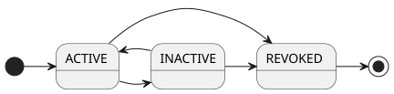

---
puppeteer:
    pdf:
        format: A4
        displayHeaderFooter: true
        landscape: false
        scale: 0.8
        margin:
            top: 1.2cm
            right: 1cm
            bottom: 1cm
            left: 1cm
    image:
        quality: 100
        fullPage: false
---
Verifiable Credentials format
==

- Topic
    - Definition of VC (Verifiable Credentials) data format
    - Definition of entity-specific certificate VC data
- Author: Youngho Kang
- Date: 2026-10-22
- Version: v1.1.0


Revision History
---

| Version | Date       | Changes                                          |
| ------- | ---------- | ------------------------------------------------ |
| v1.0.0  | 2024-09-03 | Initial version                                         |
| v1.1.0  | 2026-10-22 | Add reference to OID4VCI Credential status       |


<div style="page-break-after: always;"></div>

Table of Contents
---

<!-- TOC tocDepth:2..4 chapterDepth:2..6 -->

- [1. Overview](#1-overview)
    - [1.1. Reference Documents](#11-reference-documents)
- [2. General Regulations](#2-general-regulations)
    - [2.1. VC Lifecycle](#21-vc-lifecycle)
    - [2.2. Location of Claim Origin](#22-location-of-claim-origin)
    - [2.3. VC Structure](#23-vc-structure)
        - [2.3.1. Data Types and Constants](#231-data-types-and-constants)
        - [2.3.2. `Claim` object](#232-claim-object)
        - [2.3.3. `VcAttach` object](#233-vcattach-object)
        - [2.3.4. `Vc` object](#234-vc-object)
- [3. Certificate VC](#3-certificate-vc)
    - [3.1. TAS Certificate VC](#31-tas-certificate-vc)
        - [3.1.1. Credential Metadata](#311-credential-metadata)
        - [3.1.2. Claims](#312-claims)
    - [3.2. Provider Certificate VC](#32-provider-certificate-vc)
        - [3.2.1. Credential Metadata](#321-credential-metadata)
        - [3.2.2. Claims](#322-claims)

<!-- /TOC -->

## 1. Overview

This document defines the data structure of Verifiable Credentials (VC) used in OpenDID.
The basic regulations comply with the W3C `[VC-MODEL]` (Verifiable Credentials Data Model v2.0).

The following must adhere to the definitions in this document.

- Claim data structure
- Proof structure for selective disclosure
- Metadata specified in this document

The following are _out of the scope_ of this document and can be defined freely by the implementation.

- Evidence rules
- Extended Claim data format
- Addition of constants
- Additional items based on the regulations of this document

### 1.1. Reference Documents

| Reference   | Document Name                                         | Location                                  |
| ----------- | ----------------------------------------------------- | ----------------------------------------- |
| [VC-MODEL]  | Verifiable Credentials Data Model v2.0                | https://www.w3.org/TR/vc-data-model-2.0/  |
| [VC-IMPL]   | Verifiable Credentials Implementation Guidelines 1.0  | https://www.w3.org/TR/vc-imp-guide/       |
| [VC-DATA]   | Verifiable Credential Data Integrity 1.0              | https://w3c.github.io/vc-data-integrity   |
| [OSD]       | OpenDID Schema Definition Language                    |                                           |
| [DATA-SPEC] | (OpenDID) Data Specification                          |                                           |


<div style="page-break-after: always;"></div>

## 2. General Regulations

### 2.1. VC Lifecycle

The lifecycle of a VC is managed in the VC storage medium.
Detailed retrieval methods are out of the scope of this document and are omitted here, with only the state changes of the lifecycle described.

| State Value | State Name | Description                                                        |
| ----------- | ---------- | ------------------------------------------------------------------ |
| `ACTIVE`    | Normal     | • Usable state<br>• Can transition to suspended or revoked state   |
| `INACTIVE`  | Suspended  | • Temporarily suspended due to loss report, etc.<br>• Can transition to normal state |
| `REVOKED`   | Revoked    | • No longer in use and revoked<br>• Cannot transition to other states |



> **Note** SD-JWT VC and mdoc issued through OID4VCI use the Token Status List statuses (`VALID`, `SUSPENDED`, `INVALID`) instead of the states above.
> For status values and status transitions, refer to [Credential Status format](../oid4vc%20credential%20format/Credential%20Status%20format.md).

### 2.2. Location of Claim Origin

The origin location of claim values can be expressed as follows.

| `location` | Origin Location     | `value`                                 |
| ---------- | ------------------- | --------------------------------------- |
| `inline`   | VC Inside          | Original                                |
| `remote`   | VC Remote external     | Path to the original                    |
| `attach`   | VC External attachment | Identifier pointing to the original in the attachment |

For example, a proof photo image can be issued in three ways.

- `inline`: Store the image converted to multibase in `value`
- `remote`: Store the URL of the online server in `value`
- `attach`: Store in the attachment distributed with the VC and store the identifier in the attachment in `value`

In all three cases above, the hash of the proof photo must be stored in `digestSRI` for authenticity verification.

### 2.3. VC Structure

Refer to `[DATA-SPEC]` for items not defined here.

#### 2.3.1. Data Types and Constants

```c#
def string vcId      : "VC id in UUID"
def string claimCode : "Claim code"
def string vcAttachId: "VC attachment id"
def string vcDigest  : "W3C subresource integrity"

def enum ENCODING: "character encoding"
{
    "UTF-8", // ... 
}

def enum LANGUAGE: "Language code"
{
    "ko", "en", "fr", "jp", // ...
}

def enum VC_TYPE: "VC type"
{
    "VerifiableCredential": "VC",
    "CertificateVC"       : "Certificate VC issued by TAS",
}

def enum CLAIM_TYPE: "Claim type"
{
    "text", "image", "document",
}

def enum CLAIM_FORMAT: "Claim format"
{
    // text
    "plain", "html", "xml", "csv",
    
    // image
    "png", "jpg", "gif",
    
    // document
    "txt", "pdf", "word",
}

def enum LOCATION: "Claim origin data location"
{
    "inline": "Value included in VC 'value'",
    "remote": "External link URL",
    "attach": "Separate attachment",
}

def enum PROOF_TYPE: "proof type"
{
    "RsaSignature2018",
    "Secp256k1Signature2018",
    "Secp256r1Signature2018",
}

def enum PROOF_PURPOSE: "proof purpose"
{
    "assertionMethod",
    "authentication",
    "keyAgreement",
    "capabilityInvocation",
    "capabilityDelegation",
}

def enum PRESENCE: "evidence presence"
{
    "Physical": "Physical evidence like printed documents",
    "Digital" : "Digitally readable and verifiable evidence",
}

def enum EVIDENCE_TYPE: "evidence type"
{
    "DocumentVerification": "Document verification",
}

def enum CREDENTIAL_SCHEMA_TYPE: "credential schema type"
{
    "OsdSchemaCredential": "OSD VC Schema",
}

def enum ROLE_TYPE: "role type"
{
    "Tas"                 : "TAS",
    "Wallet"              : "Wallet",
    "Issuer"              : "Issuer",
    "Verifier"            : "Verifier",
    "WalletProvider"      : "Wallet Provider",
    "AppProvider"         : "CApp Provider",
    "ListProvider"        : "List Provider",
    "OpProvider"          : "OP Provider",
    "KycProvider"         : "KYC Provider",
    "NotificationProvider": "Notification Provider",
    "LogProvider"         : "Log Provider",
    "PortalProvider"      : "Portal Provider",
    "DelegationProvider"  : "Delegation Provider",
    "StorageProvider"     : "Storage Provider",
    "BackupProvider"      : "Backup Provider",
    "Etc"                 : "Other Provider",
}
```

#### 2.3.2. `Claim` object

The `Claim` object consists of `code`, `caption`, `value`, and properties.

```c#
def object Claim: "VC claim object"
{
    + claimCode    "code"     : "Claim code"
    + string       "caption"  : "Claim name"
    + string       "value"    : "Claim value"
    + CLAIM_TYPE   "type"     : "Claim type"
    + CLAIM_FORMAT "format"   : "Claim format"
    - bool         "hideValue": "Hide claim value", default(false)
    - LOCATION     "location" : "Claim origin location", default("inline")
    - vcDigest     "digestSRI": "Hash of the claim value", default(null)
    - object       "i18n"     : "Multilingual information"
    {
        + object $lang: "Information by language", variable_type(LANGUAGE), min_extend(1)
        {
            + string   "caption"  : "Claim name"
            - string   "value"    : "Claim value"
            - vcDigest "digestSRI": "Hash of the claim value"
        }
    }
}
```

- `value`: The type of value varies depending on the location
    - "inline": (`string`) Original value
    - "remote": (`url`) Original URL
    - "attach": (`vcAttachId`) Attachment identifier
- `digestSRI`
    - Required if location is not "inline"
- `i18n`: Add multilingual versions if `caption` or `value` differ by language


#### 2.3.3. `VcAttach` object

For claims with a location of "attach", the value is stored in a `VcAttach` object, a separate file that is delivered along with the VC.

```c#
def object VcAttach: "VC attachment file"
{
    + object $attachId: "Attachment data", variable_type(vcAttachId), min_extend(1)
    {
        + multibase "value": "Data converted to multibase"
    }
    
    + AssertProof "proof": "Issuer signature for the attachment"
}
```

#### 2.3.4. `Vc` object

The `Vc` object is a Verifiable Credential issued by the issuer to the holder and has the following structure:

- Credential Metadata
- Claim(s)
- Proof(s)

```c#
// Verifiable Credentials
def object Vc: "VC object"
{
    //---------------------------------------------------------------------------
    // Credential Metadata
    //---------------------------------------------------------------------------
    + array(url)     "@context": "JSON-LD context", value(["https://www.w3.org/ns/credentials/v2"])
    + vcId           "id"      : "VC id"
    + array(VC_TYPE) "type"    : "List of VC types"
    + object         "issuer"  : "Issuer information"
    {
        + did    "id"       : "Issuer did"
        - string "name"     : "Issuer name", emptiable(false)
    }
    + utcDatetime   "issuanceDate" : "Issuance date"
    + utcDatetime   "validFrom"    : "Valid from date"
    + utcDatetime   "validUntil"   : "Valid until date"
    + ENCODING      "encoding"     : "VC file encoding", default("UTF-8")
    + string        "formatVersion": "VC format version", default("1.0")
    + LANGUAGE      "language"     : "VC file language code"
    + array(object) "evidence"     : "Evidence"
    {
        - url           "id"      : "URL for additional information on the evidence"
        + EVIDENCE_TYPE "type"    : "Evidence type"
        + did           "verifier": "Evidence verifier"

        // Data specific to evidence type
        + select(1)
        {
            ^ group // when type == "DocumentVerification"
            {
                + string   "evidenceDocument": "Name of the evidence document"
                + PRESENCE "subjectPresence" : "Mode of subject presence"
                + PRESENCE "documentPresence": "Mode of document presence"
                - string   $attribute        : "Additional document information, e.g., license number", emptiable(false)
                {
                    - string $key: "string type key-value pair", $min_extend(1)
                }
            }
        }
    }
    + object "credentialSchema": "Credential schema"
    {
        + url                    "id"  : "VC Schema URL"
        + CREDENTIAL_SCHEMA_TYPE "type": "VC Schema format type"
    }

    //---------------------------------------------------------------------------
    // Claim(s)
    //---------------------------------------------------------------------------
    + object "credentialSubject": "Credential subject"
    {
        + did          "id"    : "Subject did"
        + array(Claim) "claims": "List of claims", min_count(1)
    }

    //---------------------------------------------------------------------------
    // Proof(s)
    //---------------------------------------------------------------------------
    + object "proof": "Issuer signature for the VC"
    {
        @spread(AssertProof)
        + array(multibase) "proofValueList": "Signatures for individual claims"
    }
}
```

**■ Changes from Previous Version**

- `Vc:~/proof` is a single object, not an array.
- `Vc:~/evidence[]/type` is a string, not an array.

##### 2.3.4.1. Credential Metadata

- `~/id`: The VC id is recommended to be of UUID type, but various formats can be used depending on the implementation.
- `~/type`: The VC type depends on the implementation.
- `~/issuanceDate`, `~/validFrom`, `~/validUntil`: All datetime values use UTC offset 0 representation.
- `~/formatVersion`: This is the version of the VC format, which depends on the implementation.
- `~/language`: Indicates the primary language of the VC. Additional languages are added as language-specific objects in `Claim:~/i18n`. See the example below.
    ```json
    {
        "language": "ko",

        "credentialSubject": {
            "id": "did:omn:12345678abcdefg",
            "claims": [
                {
                    "code": "name",
                    "caption": "성명",
                    "value": "홍길동",
                    "type": "text",
                    "format": "plain",
                    "i18n": {
                        "en": {
                            "caption": "Name",
                            "value": "Hong Gildong"
                        }
                    }
                }
            ]
        }
    }
    ```
- `~/evidence[]`
    - Currently, only the "DocumentVerification" type is defined.
    - `~/evidence[]/$attribute` can have various forms and quantities of additional attributes based on the value of `evidenceDocument`.
        - Example: If `evidenceDocument` is a driver's license, additional attributes such as license number and issuance date can be stored.


##### 2.3.4.2. Claims

If supporting multiple subjects, the structure of `~/credentialSubject` is changed to an array as follows.

```c#
+ array(object) "credentialSubject": "list of credential subjects"
{
    + did          "id"    : "subject did"
    + array(Claim) "claims": "List of claims", min_count(1)
}
```

##### 2.3.4.3. Proofs

The issuer's signature for the VC is stored in the `~/proof` object and the signature values are generated in the following two ways:

1. Full signature: A signature that includes all claims
2. Individual signatures: Signatures that include only one claim from the `~/credentialSubject/claims[]` array

| Signature Type | Signature Value             | Target Claim                  |
| :------------: | --------------------------- | ----------------------------- |
| Full Signature | `~/proof/proofValue`        | All claims                    |
| Individual     | `~/proof/proofValueList[0]` | `~/credentialSubject/claims[0]` |
| Signatures     | `~/proof/proofValueList[1]` | `~/credentialSubject/claims[1]` |
|                | ...                         | ...                           |
|                | `~/proof/proofValueList[n]` | `~/credentialSubject/claims[n]` |


<div style="page-break-after: always;"></div>

## 3. Certificate VC

A "Certificate VC" is a type of certificate issued in the form of a VC by TAS to an entity immediately after the creation of a DID Document. The following types are available:

- TAS Certificate VC
- Provider Certificate VC

### 3.1. TAS Certificate VC

#### 3.1.1. Credential Metadata

- `~/type`: ["VerifiableCredential", "CertificateVC"]
- `~/issuer`
    - `id`: TAS did
    - `name`: "TAS"
- `~/evidence`
    - `[0]`
        - `type`: "DocumentVerification"
        - `verifier`: TAS did
        - `evidenceDocument`: "BusinessLicense"
        - `subjectPresence`: "Physical"
        - `documentPresence`: "Physical"
        - `licenceNumber`: License number of the document

#### 3.1.2. Claims

- `~/credentialSubject`
    - `id`: TAS did
    - `claims`: See the table below

| code                     | caption      | type   | format  | attribute | value (example)       |
| ------------------------ | ------------ | ------ | ------- | --------- | --------------------- |
| `org.opendid.v1.subject` | "Subject DN" | "text" | "plain" |           | "o=YourCompany,c=KR"  |
| `org.opendid.v1.role`    | "Role"       | "text" | "plain" |           | "Tas"                 |

### 3.2. Provider Certificate VC

#### 3.2.1. Credential Metadata

- `~/type`: ["VerifiableCredential", "CertificateVC"]
- `~/issuer`
    - `id`: TAS did
    - `name`: "TAS"
- `~/evidence`
    - `[0]`
        - `type`: "DocumentVerification"
        - `verifier`: TAS did
        - `evidenceDocument`: "BusinessLicense"
        - `subjectPresence`: "Physical"
        - `documentPresence`: "Physical"
        - `licenceNumber`: License number of the document

#### 3.2.2. Claims

- `~/credentialSubject`
    - `id`: Provider did
    - `claims`: Refer to the table below

| code                     | caption      | type   | format  | attribute | value (example)       |
| ------------------------ | ------------ | ------ | ------- | --------- | --------------------- |
| `org.opendid.v1.subject` | "Subject DN" | "text" | "plain" |           | "o=YourCompany,c=KR"  |
| `org.opendid.v1.role`    | "Role"       | "text" | "plain" |           | "WalletProvider"      |